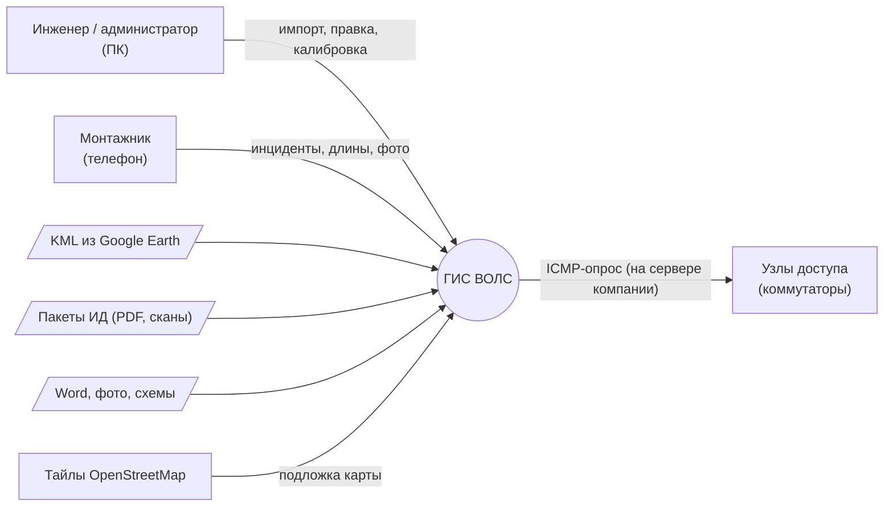
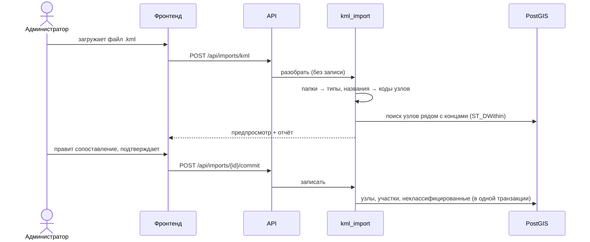
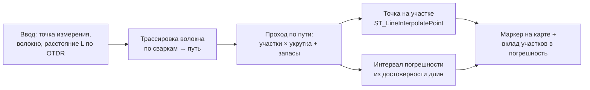

# Архитектура ГИС ВОЛС

## 1. Назначение и границы системы

Система хранит актуальную схему волоконно-оптической сети (трассы, кабели, волокна,
сварки, кроссы, узлы доступа), позволяет собирать её из разнородных источников и по
показаниям рефлектометра определять место повреждения на карте.



## 2. Компоненты

Система — **модульный монолит**: одно приложение FastAPI отдаёт REST API и статический
фронтенд, рядом работает база PostgreSQL + PostGIS. Фоновые задачи (опрос узлов)
выполняются планировщиком внутри того же процесса.

```mermaid
flowchart TB
    subgraph client["Браузер (ПК / iPhone)"]
        ui["Фронтенд: HTML + JavaScript (ES-модули)<br/>Leaflet, Leaflet-Geoman, markercluster"]
    end

    subgraph app["Контейнер app: Python 3.12, FastAPI"]
        api["API-слой<br/>/api/... (маршруты, схемы Pydantic, авторизация)"]
        subgraph services["Сервисный слой (бизнес-логика)"]
            imp["Импорт<br/>KML · ИД · DOCX · SHP"]
            qc["Проверка качества ИД"]
            graph["Граф сети<br/>трассировка · локализация · калибровка"]
            mon["Мониторинг узлов<br/>ping / имитация"]
            ocr["OCR / EXIF"]
            anon["Обезличивание<br/>генератор данных"]
        end
        orm["Слой данных: SQLAlchemy 2 + GeoAlchemy2"]
        sched["Планировщик APScheduler"]
        files[("Файлы: /data/uploads")]
    end

    db[("Контейнер db:<br/>PostgreSQL 16 + PostGIS 3.4")]

    ui -- "HTTPS / JSON, GeoJSON" --> api
    api --> services
    services --> orm
    orm --> db
    sched --> mon
    imp --> files
    ocr --> files
```

### Слои и правила зависимостей

| Слой | Каталог | Что делает | Может обращаться к |
|---|---|---|---|
| API | `app/api` | HTTP-маршруты, проверка прав, преобразование в/из JSON | сервисы, схемы |
| Схемы | `app/schemas` | Pydantic-модели запросов и ответов | — |
| Сервисы | `app/services` | Вся логика: импорт, граф, проверки, OCR | модели, БД |
| Модели | `app/models` | ORM-таблицы, ограничения | — |
| Ядро | `app/core` | Настройки, подключение к БД, безопасность | — |

Правило: **маршруты API не содержат бизнес-логики**, а сервисы не знают про HTTP.
Поэтому алгоритмы (трассировка, локализация, разбор ИД) тестируются без веб-сервера
и одинаково вызываются из API, из CLI и из скриптов эксперимента.

### Модули сервисного слоя

| Модуль | Отвечает за | Этап |
|---|---|---|
| `services/kml_import` | разбор KML, сопоставление папок, разбор названий, привязка концов | 4 |
| `services/editing` | прокладка кабеля по трассе, перенос и объединение узлов | 4–5 |
| `services/splicing` | муфты, сварки, кроссы, валидация рассветки | 6 |
| `services/graph` | построение графа, трассировка волокна | 7 |
| `services/localization` | локализация по рефлектометру, интервал погрешности | 7 |
| `services/calibration` | поправки длин и укрутки по инцидентам и измерениям ИД | 8 |
| `services/asbuilt` | разбор пакетов ИД (из прототипа `id_parser.py`), правила — в YAML | 9 |
| `services/asbuilt_qc` | проверки согласованности ИД | 9 |
| `services/monitoring` | опрос узлов доступа, история статусов | 11 |
| `services/photo_coords` | EXIF и OCR координат с фото | 11 |
| `services/anonymize`, `tools/generate` | обезличивание реальных данных, генератор сети | 2, 12 |

## 3. Ключевые потоки данных

### 3.1 Импорт KML



Импорт выполняется в **два шага** (разбор → подтверждение): ошибочный файл не портит
базу, а пользователь видит, что именно будет создано.

### 3.2 Локализация повреждения



Оптическая длина участка: `L_опт = L_физ × (1 + k_укрутки)`; запас в узле добавляется
целиком. Погрешность каждой длины берётся из её источника (`LengthSource`), суммарная
погрешность — как корень из суммы квадратов (независимые ошибки).

### 3.3 Импорт пакета ИД

PDF → классификация страниц по заголовкам (правила в YAML) → извлечение со страниц с
текстом → OCR сканов → проверки согласованности → экран проверки → запись объектов
с источником `as_built` и ссылкой на пакет.

## 4. Развёртывание

| Среда | Где | Особенности |
|---|---|---|
| Разработка и демонстрация | ноутбук, Windows 10 + Docker Desktop (WSL2) | `MONITORING_MODE=simulate`: нет сетевого доступа к узлам, статусы имитируются |
| Эксплуатация | сервер компании (Linux + Docker) | `MONITORING_MODE=ping`, свой `SECRET_KEY`, резервные копии БД |
| CI | GitHub Actions | контейнер PostGIS, `ruff` + `pytest` на каждый push |

Обе среды запускаются одним `docker compose up -d --build`; переезд на сервер —
перенос репозитория, файла `.env` и дампа базы.

Контейнеры: `db` (PostgreSQL + PostGIS), `app` (FastAPI + статический интерфейс, порт 8000),
`https` (Caddy — HTTPS-прокси для телефонов на порту 8443 с сертификатом локального центра
сертификации на адрес `PHONE_HOST`; браузер даёт геолокацию и камеру только по https).

## 5. Сквозные решения

- **Система координат:** всё хранится в EPSG:4326 (WGS-84, как в KML и GPS телефона).
  Длины считаются через `geography` — в метрах по эллипсоиду, без перепроецирования.
- **Происхождение данных:** у каждого объекта есть `source_kind` (manual / kml /
  asbuilt / generator) и ссылка на импорт или пакет ИД — видно, откуда взялась запись.
- **Достоверность длин:** у каждой длины свой источник и погрешность — основа
  интервала погрешности локализации и калибровки.
- **Аудит:** любое изменение пишется в `audit_log` (кто, когда, было → стало).
- **Обезличивание:** реальные схемы в репозиторий не попадают (`.gitignore`), для
  демонстрации есть генератор и скрипт обезличивания.

Обоснование выбора технологий — в [decisions.md](decisions.md), модель данных —
в [er.md](er.md).
