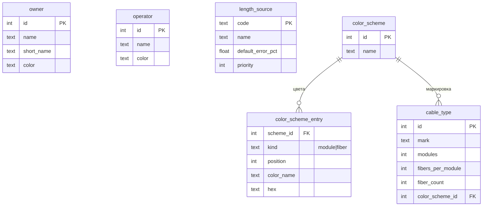
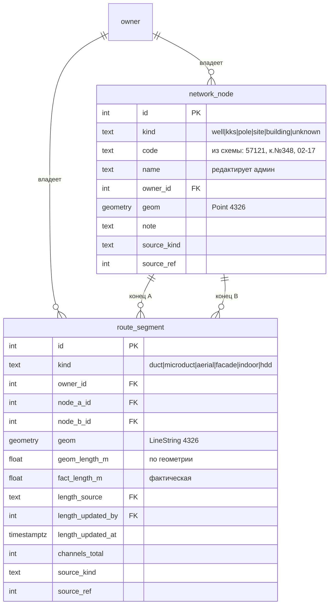
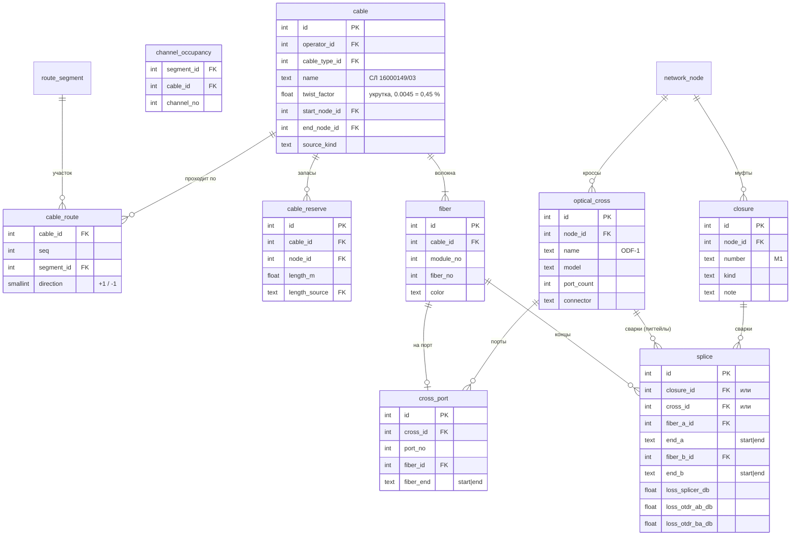
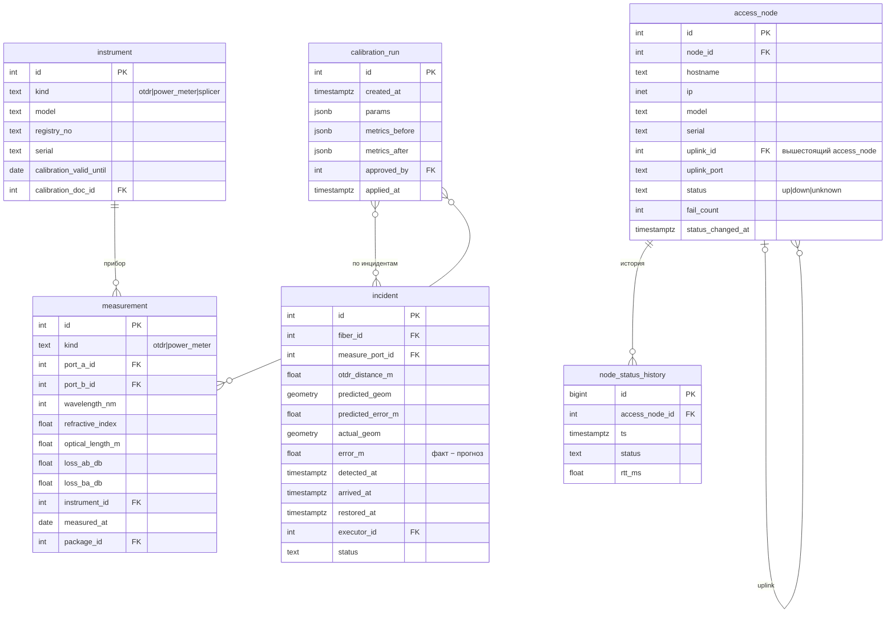
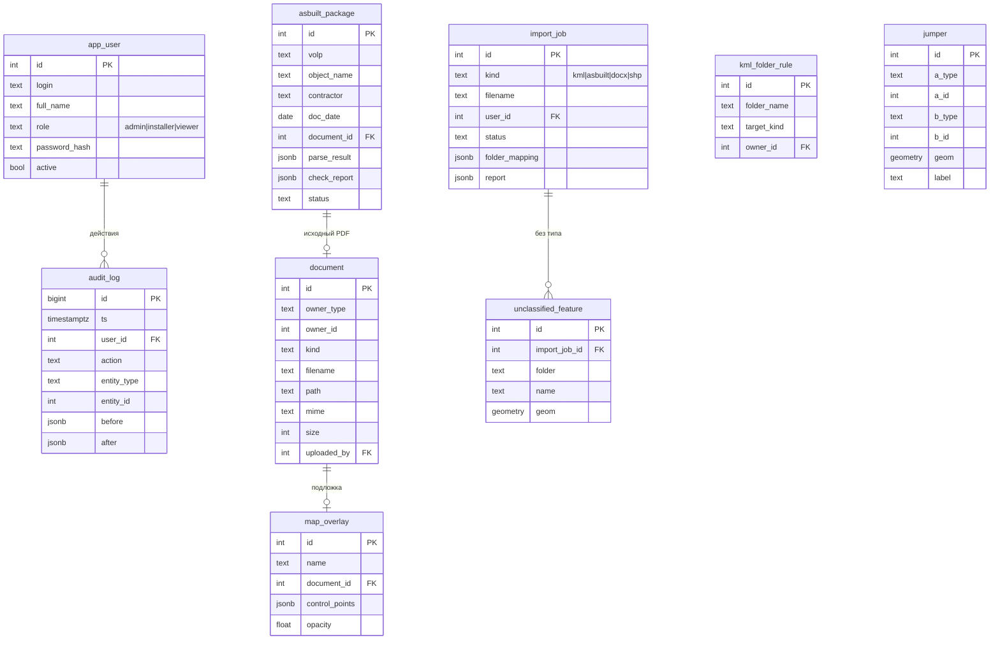

# Модель данных

Модель разбита на пять групп: справочники, инфраструктура (трассы), кабельная часть
(кабели, волокна, сварки), измерения и инциденты, документы и служебные таблицы.

## Принципы

1. **Инфраструктура отделена от кабелей.** Колодцы, опоры и участки трасс принадлежат
   владельцу (Таттелеком, Телесет…), кабели — оператору (Ростелеком, МТС…).
   Кабель проходит по упорядоченной цепочке участков (`cable_route`).
2. **Рассветка нормализована.** Каждая сварка — строка `splice`, связывающая два
   конца волокон. Из этих строк строится граф для трассировки; JSON не используется.
3. **Каждая длина имеет источник** (`length_source`) с погрешностью по умолчанию —
   основа интервала погрешности при локализации и калибровки.
4. **Каждый объект знает своё происхождение**: `source_kind` (manual / kml / asbuilt /
   generator) и `source_ref` (номер импорта или пакета ИД).
5. **Геометрия — EPSG:4326**, длины в метрах через `geography`.

## 1. Справочники

`length_source`: `reflectometer` 1 %, `as_built` 2 %, `passport` 5 %, `engineer` 10 %,
`geometry` 25 %. `priority` определяет, какая длина берётся, если известно несколько.

Стандартная схема из 8 цветов: синий, оранжевый, зелёный, коричневый, серый, белый,
красный, чёрный (например, ОКГ-8, ОКЛ-8 в ИД Чапаева 62Б).

## 2. Инфраструктура

Узел (`network_node`) — любая точка сети: колодец, ККС, опора, площадка БС, здание.
`code` нужен для привязки при импорте KML («к.№348 - к.№498»), `name` — для людей.

## 3. Кабели, волокна, сварки

**Концы волокна.** У каждого волокна два конца: `a` — у начала кабеля (start_node) и
`b` — у конца (end_node). Конец может участвовать не более чем в одной сварке или быть заведён не более
чем на один порт кросса — это и есть правило «одно волокно — одна сварка».
Проверяется триггерами PL/pgSQL на `splice` и `cross_port` (миграция 0003): база
отклоняет повторное подключение конца волокна при любом способе записи.

**Пример из ИД Чапаева 62Б:** ODF-4 порт 78 → ДПО-П-08У ОВ 3 → сварка в УД
16ELBG-ACCF00-173 → ОКЛ-8 ОВ 2 → сварка в муфте М1 → ОКГ-8 ОВ 1 → ODF-1 порт 1.

## 4. Узлы доступа, измерения, инциденты

`sim_truth` — «истинные» значения синтетической сети (длины участков и запасов, укрутка
кабелей, оптические длины трактов). Заполняется только генератором и используется
только в эксперименте: система её не читает.

`measurement` из пакетов ИД — эталон для калибровки: оптическая длина тракта измерена
прибором (в примере 2,627 км), а система считает её по графу и сравнивает.

## 5. Документы, импорт, служебные

`document` и `jumper` ссылаются на объекты полиморфно (`owner_type` + `owner_id`):
файл можно прикрепить к муфте, узлу, кабелю или пакету ИД одной таблицей.

`parse_result` и `check_report` в пакете ИД — JSON: это сырой результат разбора и
отчёт проверки (как они пришли из документа). Данные сети из них переносятся в
нормализованные таблицы только после подтверждения пользователем.
