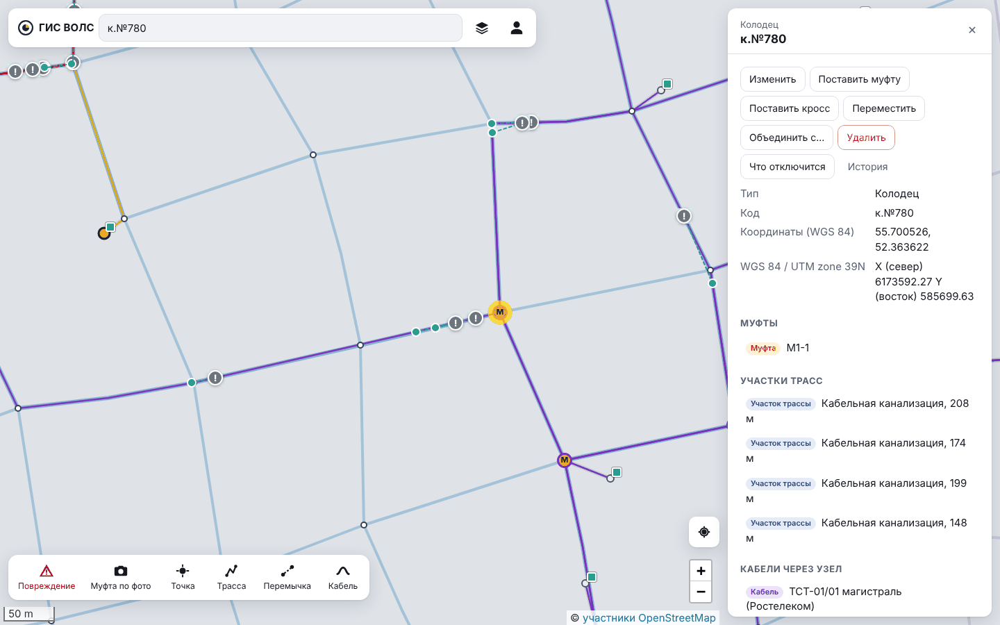
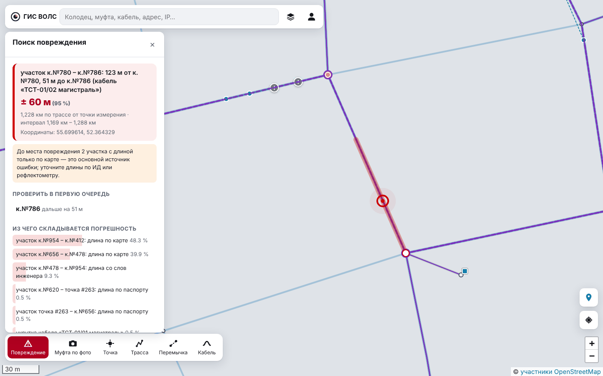
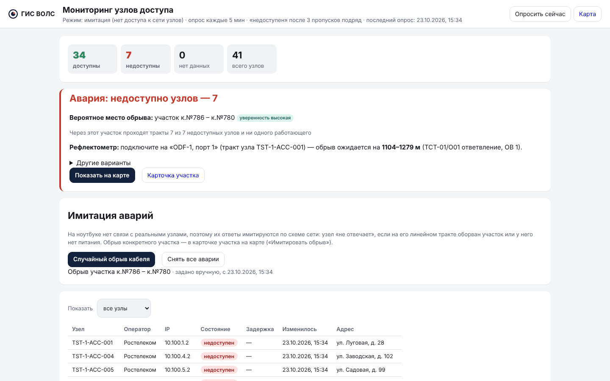
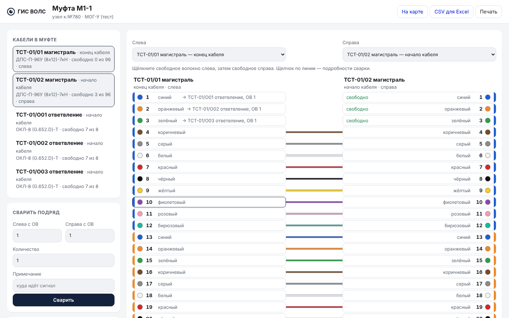
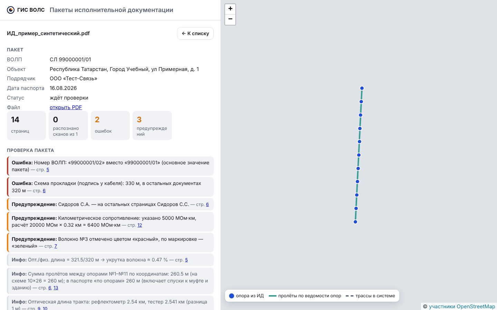
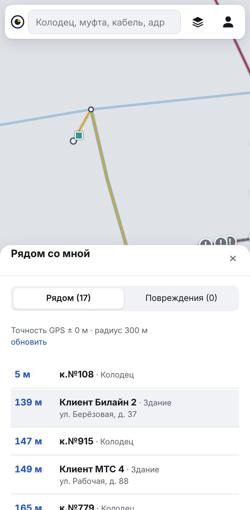
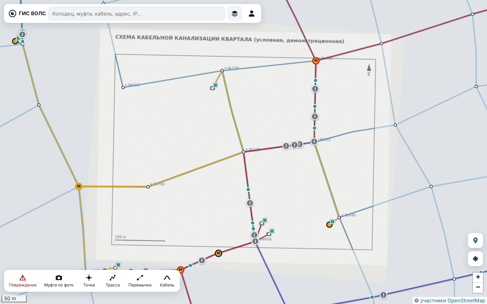

# Демонстрационные сценарии

Как показать систему руководителю или комиссии: подготовка, сценарии с шагами, что
говорить, какие результаты ожидать, что делать при сбое и ответы на вероятные вопросы.

Все сценарии рассчитаны на **тестовую сеть из `generate.bat`**. Она одинаковая при каждом
запуске, поэтому коды колодцев и числа ниже совпадут с тем, что вы увидите. Если до показа
применялась калибровка или сеть менялась вручную, числа будут немного другими — это
нормально.

## Главная мысль показа

Три тезиса, к которым стоит возвращаться:

1. **Сеть ведётся на карте целиком**: трассы, кабели, муфты со сварками, кроссы и
   коммутаторы связаны между собой. Поэтому система может пройти по волокну от порта
   кросса через все сварки.
2. **Место повреждения находится автоматически и с честной оценкой точности**: не просто
   «точка на карте», а интервал ± м, колодцы для проверки и объяснение, откуда берётся
   ошибка. Ручной способ «по линии на карте» ошибается в среднем на ~110 м, система — на
   ~18 м, после калибровки — на ~4 м (эксперимент, медианы).
3. **Система учится и проверяет данные**: калибровка по фактическим ремонтам, проверка
   пакетов ИД подрядчиков, импорт из ГИС в местной системе координат.

## Подготовка

### Накануне (30 минут)

| № | Действие | Зачем |
|---|---|---|
| 1 | Запустить `start.bat`, дождаться открытия браузера | после обновления первый запуск пересобирает систему — несколько минут |
| 2 | Запустить `generate.bat` | чистая тестовая сеть и 40 устранённых повреждений — числа в сценариях совпадут |
| 3 | Войти `admin` / `Vols-2026` → меню → **Эксперимент (ВКР)** → **Запустить быстрый** (≈3–4 мин) | графики готовы к показу, ждать на показе не придётся |
| 4 | Меню → **Калибровка**: если есть применённый прогон — **Отменить калибровку** | калибровку покажем в сценарии 4 «вживую» |
| 5 | Запустить `phone.bat`, открыть систему на телефоне по QR-коду, войти `montazhnik` | проверить, что телефон видит ноутбук; разрешить местоположение и камеру |
| 6 | Скопировать на телефон `data/samples/demo/mufta_po_foto.jpg` (если будете показывать «Муфту по фото» с телефона) | фото с координатами рядом с тестовой сетью |
| 7 | Проверить, что открывается `data/samples/ИД_пример_синтетический.pdf` | для сценария 6 |

### За 15 минут до показа

- Ноутбук на зарядке, режим сна выключен, уведомления отключены.
- `start.bat` (если система не запущена).
- Меню → **Мониторинг узлов** → **Снять все аварии** (имитатор иногда сам создаёт аварию).
- Открыть вкладки браузера: карта (вход `admin`), Мониторинг узлов, Эксперимент (ВКР).
- Открыть папку `data/samples/demo` в Проводнике — оттуда будем брать файлы.
- Масштаб браузера 100–110 %, лучше полноэкранный режим (F11).

### Файлы для показа

Лежат в `data/samples/demo/` и построены по тестовой сети (все данные вымышленные):

| Файл | Для чего |
|---|---|
| `ИД_пример_синтетический.pdf` (в `data/samples/`) | пакет ИД с заложенными ошибками |
| `foto_kolodec_1.jpg`, `foto_kolodec_2.jpg` | фото с координатами в 4 м от колодцев к.№108 и к.№779 |
| `foto_novaya_tochka.jpg` | фото в стороне от сети — будет предложена новая точка |
| `mufta_po_foto.jpg` | фото с подписью координат как у NoteCam — «Муфта по фото» поставит муфту на трассу |
| `plan_kvartala.png` | «скан» схемы канализации квартала для привязки |
| `novaya_ulica_utm39.zip` | Shapefile новой улицы в метрах (UTM 39N) с .prj |
| `utm39_primer.prj` | файл системы координат — пример вместо .prj МСК |

## Порядок показа

| № | Сценарий | Время | Короткий показ (10 мин) |
|---|---|---|---|
| 0 | Вступление: задача и подход | 1 мин | ✅ |
| 1 | Сеть на карте | 2 мин | ✅ |
| 2 | **Поиск места повреждения по рефлектометру** | 4 мин | ✅ |
| 3 | **Авария по мониторингу → место обрыва** | 3 мин | ✅ |
| 4 | **Калибровка и результаты эксперимента** | 3 мин | ✅ |
| 5 | Рассветка и трасса волокна | 2 мин | |
| 6 | Проверка пакета ИД подрядчика | 3 мин | |
| 7 | Телефон монтажника: рядом со мной, муфта по фото | 3 мин | |
| 8 | Обмен с ГИС: МСК, Shapefile, подложка | 4 мин | |
| 9 | Итог | 1 мин | ✅ |

Полный показ — около 25 минут. Если времени 5 минут: сценарии 2, 3 и графики из 4.

---

## Сценарий 0. Вступление

**Что сказать.** «Сейчас схемы ВОЛС ведутся в Google Earth и бумажных документах. При
обрыве монтажник меряет расстояние рефлектометром и вручную отмеряет его по линии на карте
или по длинам из документации. Ошибка — сотни метров: реальная трасса длиннее нарисованной,
в колодцах запасы кабеля, волокно в кабеле длиннее самого кабеля. Я сделал ГИС, которая
хранит сеть вместе со сварками и автоматически находит место повреждения с оценкой
точности. Показываю на сгенерированной сети — реальные данные компании в проект не
попадают».

## Сценарий 1. Сеть на карте

**Цель:** показать, что сеть хранится целиком и связно.

| Действие | Что увидят | Что сказать |
|---|---|---|
| Карта открыта под `admin` | сеть квартала: трассы, кабели, муфты «М», коммутаторы-квадратики | «Около 300 точек, 50 кабелей, 4 оператора — сеть сгенерирована, но устроена как городская» |
| Слои → Оператор → «Ростелеком» | остаются кабели одного оператора, плашка фильтра | «Фильтры по оператору и владельцу инфраструктуры» |
| Сбросить фильтр (крестик на плашке) | вся сеть | |
| Поиск: `к.№780` → открыть | карточка колодца: муфта М1-1, участки, кабели через узел | «Объекты связаны: в колодце муфта, через него идут кабели, у участков длина и её источник» |
| В карточке щёлкнуть муфту **М1-1** | карточка муфты | |

## Сценарий 2. Поиск места повреждения ★

**Цель:** главная функция — от показания рефлектометра к месту на карте.

**Легенда:** «Абонент дома "Клиент Ростелеком 9" без связи. Монтажник в узле связи
53937 подключил рефлектометр к кроссу ODF-1, порт 9, и видит обрыв на 1234,5 м».

| Действие | Что увидят | Что сказать |
|---|---|---|
| **Повреждение** на нижней панели | панель «Поиск повреждения» | |
| Кросс: ввести `53937`, выбрать «53937 · ODF-1 · ул. Садовая, д. 13» | список портов | «Видно, какое волокно какого кабеля на каждом порту» |
| Порт: **9 — ТСТ-01/01 магистраль, ОВ 9** | | |
| **Показать трассу** | путь волокна на карте, таблица событий: сварки в М1-1 (≈1094 м), М1-2 (≈1306 м), М1-3 (≈1516 м), конец — «Клиент Ростелеком 9» (≈1896 м) | «Система прошла по сваркам через три муфты — это то, что монтажник увидит на рефлектограмме» |
| Расстояние `1234.5` → **Найти место** | **участок к.№780 – к.№786: 123 м от к.№780, 51 м до к.№786**, интервал **≈ ±60 м (95 %)**, «Проверить в первую очередь: к.№786» | «Не точка, а интервал с вероятностью 95 %. Ближайший колодец — к.№786, в 51 м» |
| Прокрутить к «Из чего складывается погрешность» | два участка «длина по карте» дают ≈ 88 % ошибки | «Система объясняет, откуда ошибка: два участка известны только по карте. Если их измерить, интервал сузится» |
| Дополнительно → Показание с другого конца: `662` → **Найти место** | интервал сужается до **≈ ±46 м**, расхождение двух измерений ≈ 0 м | «Если мерили с обеих сторон, система совмещает измерения» |
| **Сохранить повреждение** (название «Демо: обрыв на Садовой») | красный «!» на карте | «Повреждение попадает в журнал, монтажник видит его на телефоне с маршрутом» |

**Если спросят «а как без системы?»** — «По линии на карте вышло бы на 5–10 % дальше или
ближе: на 1,2 км это 60–120 м, и неизвестно, в какую сторону. В эксперименте ручной способ
ошибается в среднем на 113 м против 18 м у системы».

## Сценарий 3. Авария по мониторингу ★

**Цель:** система сама замечает аварию и подсказывает, где искать обрыв, ещё до выезда.

| Действие | Что увидят | Что сказать |
|---|---|---|
| Закрыть панель поиска повреждения. Щёлкнуть на карте участок, где система нашла повреждение (между к.№780 и к.№786; если карта сдвинута — поиск `к.№786` и приблизить) | карточка участка «к.№786 — к.№780» | |
| **Что отключится** | **7 узлов доступа** Ростелекома со списком | «Перед плановыми работами видно, каких абонентов предупредить» |
| Назад к карточке → **Имитировать обрыв** | | «На ноутбуке нет связи с реальными коммутаторами, поэтому их ответы имитируются по схеме: обрыв этого участка "гасит" узлы за ним» |
| Вкладка **Мониторинг узлов** (обновить) | 7 недоступны; блок **Авария**: «Вероятное место обрыва: участок к.№786 – к.№780», уверенность высокая; «подключите на ODF-1, порт 1 — обрыв ожидается на **1104–1279 м**» | «Система нашла участок, через который идут тракты всех 7 упавших узлов и ни одного работающего, и подсказала, куда подключить рефлектометр и где ждать обрыв» |
| **Показать на карте** | участок подсвечен, недоступные узлы обведены | |
| **Снять все аварии** | все узлы на связи | |

**Важно:** узел помечается недоступным после 3 пропусков опроса подряд; при имитации
система делает эти опросы сразу. На сервере компании опрос настоящий (`MONITORING_MODE=ping`).

## Сценарий 4. Калибровка и эксперимент ★

**Цель:** показать, что система учится на ремонтах, и доказать выигрыш в точности.

| Действие | Что увидят | Что сказать |
|---|---|---|
| Меню → **Журнал повреждений** | 40 устранённых повреждений: прогноз, фактическое место, ошибка, «в интервале» | «После ремонта монтажник отмечает фактическое место по GPS — так копятся данные» |
| Меню → **Калибровка** → **Рассчитать калибровку** (≈10–30 с) | ≈60 наблюдений; «реальная трасса длиннее нарисованной на ≈ +10 %»; моделирование: средняя ошибка места ≈ 20 → 6 м; укрутка по маркам кабеля | «По измерениям из ИД и отмеченным ремонтам система подбирает укрутку марок кабеля и поправку длин "по карте". Проверка на отложенных данных показывает, что предсказания стали точнее» |
| **Применить** | | |
| Вернуться на карту → **Повреждение** → тот же кросс 53937, порт 9, `1234.5` → **Найти место** | интервал **≈ ±33 м** вместо ±60, точка сдвинулась (≈ 94 м от к.№780) | «Тот же замер — интервал почти вдвое уже» |
| Вкладка **Эксперимент (ВКР)** | графики E1–E5 готового прогона | «Эксперимент на сгенерированных сетях с известной правдой: одни и те же повреждения, четыре способа» |
| Показать E1 | ручной «по карте» — медиана 113 м, «по документации» — 77 м, система — 18 м, после калибровки — 4 м (полный прогон) | «Попадание в интервал 99 %, то есть интервал честный» |
| Показать E4 | при полных данных место обрыва по аварии — в 100 % случаев в лучшем отрезке | |
| Калибровка → **Отменить калибровку** | | вернуть исходное состояние для следующих показов |

Полные таблицы — [experiment-results.md](../vkr/experiment-results.md). Числа быстрого
прогона немного отличаются от полного: в нём меньше сетей и повреждений.

## Сценарий 5. Рассветка и трасса волокна

| Действие | Что увидят | Что сказать |
|---|---|---|
| Поиск `М1-1` → **Рассветка** | схема сварок: ТСТ-01/01 слева, ТСТ-01/02 справа, цветные линии сварок | «Цвета по маркировке волокон. Именно по этим сваркам система проходит в поиске повреждения» |
| Щёлкнуть линию сварки 4–4 (коричневая) | потери, примечание, «Разварить» | «Сварка создаётся так: щелчок по свободному волокну слева, затем справа» |
| Прокрутить вниз — «Замечания» и «Все сварки муфты» | подсказки: транзитные кабели, непроваренные волокна | |
| **CSV для Excel**, **Печать** | | «Схему можно выгрузить и распечатать для бригады» |

## Сценарий 6. Проверка пакета ИД подрядчика

**Легенда:** «Подрядчик сдал исполнительную документацию на новую линию — 14 страниц.
Проверять вручную долго, ошибки пропускают».

| Действие | Что увидят | Что сказать |
|---|---|---|
| Меню → **Пакеты ИД** → перетащить `data/samples/ИД_пример_синтетический.pdf` | статус «разбирается», затем пакет открывается (распознавание сканов может занять 1–2 минуты) | «Пакет синтетический, ошибки заложены специально» |
| Раздел «Проверка пакета» | ошибки: номер ВОЛП 99000001/02 вместо /01 (стр. 5); длина на схеме 330 м, в остальных документах 320 м (стр. 6); предупреждения: инициалы Сидоров С.А./С.С., неверный расчёт сопротивления изоляции, цвет волокна №3 | «Каждая находка со ссылкой на страницу. Система сверяет документы пакета между собой» |
| Щёлкнуть ссылку «стр. 6» | открывается страница PDF | |
| Показать карту справа | опоры из пакета | |
| (по желанию) **Отклонить пакет** с причиной | | «Пакет возвращается подрядчику; правильный пакет можно подтвердить и записать измерения и сварки в сеть» |

## Сценарий 7. Телефон монтажника

Показывайте с телефона (подготовка, п. 5) или в браузере ноутбука в режиме телефона:
**F12** → значок телефона (Toggle device toolbar) → обновить страницу.

**Важно про местоположение.** Тестовая сеть расположена условно, и если вы далеко от неё,
«Рядом со мной» покажет пустой список, а до повреждения будут сотни километров. Для
показа подмените местоположение в браузере ноутбука: **F12** → «⋮» → More tools →
**Sensors** → Location → Other… → широта `55.7025`, долгота `52.3547` (у колодца к.№108).
На телефоне этот шаг пропустите и скажите, что на реальной сети список строится по GPS.

| Действие | Что увидят | Что сказать |
|---|---|---|
| Телефон: карта под `montazhnik` | та же карта, крупные кнопки, карточка — шторкой снизу | «Это не отдельное приложение, а та же система; её можно установить на главный экран» |
| **Метка справа** — «Рядом со мной» | точки сети с расстоянием; вкладка «Повреждения» — сохранённое в сценарии 2 повреждение с расстоянием и **Маршрут** | «Монтажник приезжает на место, видит ближайшие колодцы и маршрут к повреждению» |
| **Муфта по фото** → выбрать `mufta_po_foto.jpg` | «Муфта поставлена на трассу — 4 м от места съёмки», открывается карточка муфты «М1 (по фото)» с фото | «Координаты прочитаны с подписи на кадре (как у NoteCam), точность 6,5 м. Рядом нет колодца — муфта встала прямо в трассу. Если бы рядом не было линий, система поставила бы муфту с пометкой "нужно ввести данные"» |
| (по желанию) Меню → **Точки по фото** → выбрать три фото `foto_*.jpg` | к.№108 — 4 м, к.№779 — 4 м, третье фото — «новая точка здесь» | «Пачку фото колодцев можно разнести по карте за минуту» |

## Сценарий 8. Обмен с ГИС: МСК, Shapefile, подложка

**Легенда:** «Проектировщики работают в 5Gis/QGIS, в местной системе координат, в метрах.
Нужно принять их выгрузку и привязать бумажный план».

| Действие | Что увидят | Что сказать |
|---|---|---|
| Меню → **Системы координат** → Файл .prj: `utm39_primer.prj` → **Добавить** | система «WGS 84 / UTM zone 39N» в списке | «Параметры МСК не публикуются, поэтому они берутся из .prj той ГИС, где ведутся данные, — ничего не вводится вручную. Здесь вместо МСК пример UTM» |
| Карта: поиск `к.№108` | в карточке появилась строка «X (север) 6173802.69 Y (восток) 585139.57» | |
| В поиск ввести `6173802.69 585139.57` | найдена точка в этой системе — красный круг у к.№108 | «Можно искать по координатам из проекта» |
| Меню → **Импорт KML / Shapefile** → `novaya_ulica_utm39.zip` | предпросмотр: 4 новых колодца, 4 участка, на карте — новая улица от к.№812 на восток | «Координаты в метрах пересчитаны в широту и долготу по .prj из архива. Ничего не записано, пока не нажать "Записать в базу"» |
| **Записать в базу** → **Открыть на карте** | новая улица в сети | |
| Меню → **Подложки (планы)** → `plan_kvartala.png`, название → **Загрузить** | слева план, справа карта | |
| По очереди: колодец на плане → тот же колодец на карте справа. Четыре колодца по углам: к.№513, к.№466, к.№709, к.№540 (на карте наведите на кружок — появится код; щелчок по кружку ставит точку точно в колодец) | номера точек, невязка каждой точки, план ложится на карту справа | «Привязка по опорным точкам; невязка показывает ошибку отметки — если у одной точки она большая, её отметили неверно» |
| **Сохранить привязку** → карта | план под сетью полупрозрачно, совпадает с трассами | |
| Меню → **Экспорт сети** → Shapefile, система координат UTM → **Скачать** | архив .zip | «Обратно — в ГИС, в той же системе координат» |

Чем дальше точки друг от друга, тем точнее привязка. Можно показать и ошибку: отметить
пятую точку на плане у к.№108, а на карте нарочно щёлкнуть соседний колодец — у этой точки
невязка будет десятки метров, у остальных — около нуля. **Убрать последнюю точку** — и
снова всё ровно.

## Сценарий 9. Итог

**Что сказать.** «Итак: сеть хранится на карте связно, со сварками. По показанию
рефлектометра система находит место с интервалом и объясняет ошибку; по аварии
коммутаторов — участок обрыва ещё до выезда. Калибровка по ремонтам сужает интервал, а в
эксперименте медианная ошибка снизилась со 113 м при ручном способе до 18 м, после
калибровки — до 4 м. Система принимает ИД, KML и Shapefile в местной системе координат
и работает на телефоне монтажника. Готова к переносу на сервер компании».

---

## Если что-то пошло не так

| Ситуация | Что делать |
|---|---|
| Карта без улиц (серый фон) | нет интернета — сеть всё равно видна; сказать, что подложка OSM грузится из интернета |
| Мониторинг уже показывает аварию до сценария 3 | имитатор сам «оборвал» участок: **Снять все аварии**; можно и обыграть — «вот как выглядит внезапная авария» |
| В сценарии 2 другие числа | применена калибровка или сеть менялась: меню → Калибровка → Отменить калибровку; или заранее `generate.bat` |
| Порт 9 не найден / кросс 53937 не находится | сеть не из `generate.bat`: запустить `generate.bat` (≈1 мин) |
| Пакет ИД долго «разбирается» | показать находки на снимке экрана или загрузить без галочки OCR (разбор за секунды) |
| Телефон не открывает систему | показать режим телефона в браузере ноутбука (F12 → значок телефона) |
| «Муфта по фото»: «на фото не найдены координаты» | взять файл именно из `data/samples/demo`; мессенджеры удаляют данные из фото |
| Подложка легла криво | в списке точек найти точку с большой невязкой → «Убрать последнюю точку» и отметить заново |
| Страница не отвечает | обновить страницу (F5); если не помогло — `stop.bat`, `start.bat` |

## Вероятные вопросы и ответы

**Откуда берутся данные для реальной сети?** Импорт из Google Earth (KML), из ГИС
(Shapefile, в том числе в МСК), пакеты ИД подрядчиков; остальное рисуется на карте.
Реальные данные в репозиторий проекта не попадают — показ на сгенерированной сети.

**Почему интервал, а не точка?** Длины в базе известны с разной точностью: по
рефлектометру ±1 %, по ИД ±2 %, по карте — только нижняя граница. Система складывает
погрешности всех участков до места и показывает интервал 95 %. В эксперименте истинное
место попадает в интервал в 99 % случаев.

**Как учитываются запасы и укрутка?** Оптическая длина участка = физическая длина ×
(1 + укрутка марки кабеля), плюс запасы в колодцах по пути. Укрутка по маркам уточняется
калибровкой.

**Чем это лучше Google Earth?** В Google Earth — линии без связей: нет сварок, портов,
длин с источником. Без этого нельзя пройти по волокну и посчитать оптическое расстояние.

**Что если данные о сварках неполные?** Трасса волокна покажет, где путь обрывается
(«конец волокна никуда не подключён»). Повреждение на уже пройденной части находится.

**Как это работает без интернета?** Сервер работает в локальной сети. Телефон без связи
показывает последнюю загруженную карту.

**Как проверялась точность?** Эксперимент на сгенерированных сетях с известными
истинными длинами: 3 сети по 200 повреждений, четыре способа на одних и тех же
повреждениях (парное сравнение). Отдельно — поиск обрыва по аварии и быстродействие на
сетях до 1000 точек.

**Сколько стоит внедрение?** Открытое ПО (PostgreSQL/PostGIS, Python, Leaflet), один
сервер с Docker. Лицензий не нужно.

**Что с безопасностью?** Вход по логину и паролю, три роли, журнал всех изменений
(кнопка «История» в карточке), HTTPS для телефонов.

**Как перенести на сервер компании?** Тот же `docker compose`; в `.env` — адрес сервера
для телефонов и `MONITORING_MODE=ping` для настоящего опроса коммутаторов.

## После показа

- Мониторинг → **Снять все аварии**.
- Калибровка → **Отменить калибровку**, если применяли.
- Чтобы вернуть сеть к исходной (убрать импортированную улицу, муфту по фото, сохранённое
  повреждение), запустите `generate.bat`. Подложки и системы координат он не удаляет —
  при необходимости удалите их на своих страницах.
