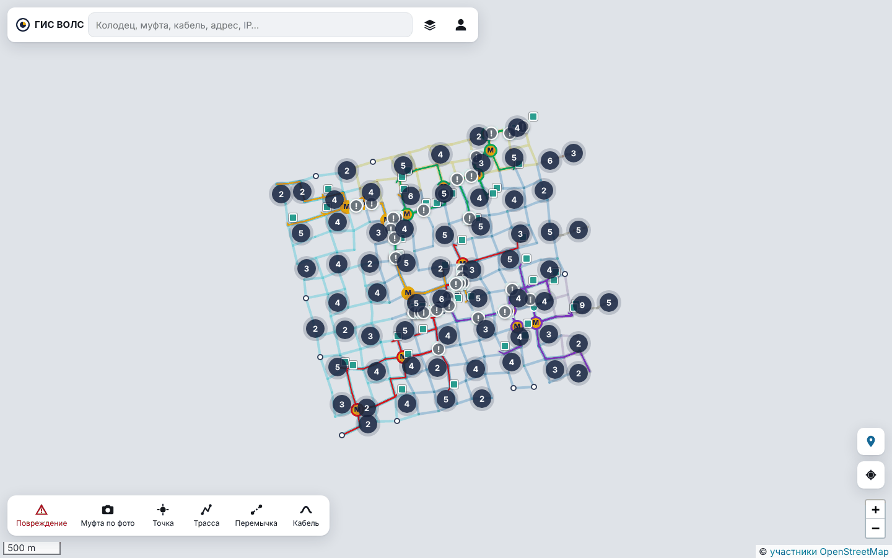

# Как пользоваться ГИС ВОЛС: быстрый старт

Короткий гайд: запуск, вход и пять основных задач. Подробности по каждой функции — в
[руководстве пользователя](user-guide.md).

## Шаг 1. Запустить

1. Запустите **Docker Desktop** и дождитесь зелёной надписи «Engine running».
2. В папке проекта дважды щёлкните **`start.bat`**. Через несколько секунд откроется
   браузер с адресом <http://localhost:8000>.
3. Если сеть пустая, дважды щёлкните **`generate.bat`** — появится тестовая сеть и
   пользователи. Внимание: `generate.bat` заменяет текущую сеть.

Остановить систему — **`stop.bat`**. Данные сохраняются.

## Шаг 2. Войти

| Логин | Роль | Для чего |
|---|---|---|
| `admin` | администратор | ведёт схему сети, импорт, калибровка, все настройки |
| `montazhnik` | монтажник | поиск повреждений, сварки, фото, работа с телефона |
| `viewer` | просмотр | только смотреть |

Пароль у всех демонстрационных пользователей — `Vols-2026`.

## Шаг 3. Освоиться на карте

- **Колесо мыши** — масштаб; **перетаскивание** — сдвиг карты.
- **Щелчок по объекту** — карточка справа: свойства, связанные объекты, кнопки действий.
- **Строка поиска** — колодец (`к.№780`), узел (`53937`), муфта (`М1-1`), кабель
  (`ТСТ-01`), адрес, IP или координаты.
- **Стопка листов** справа от поиска — слои и фильтр по оператору.
- **Человечек** — меню со всеми страницами и выход.
- **Нижняя панель** — инструменты: Повреждение, Муфта по фото, Точка, Трасса, Перемычка,
  Кабель (набор зависит от роли).

На карте: голубые линии — трассы, цветные — кабели операторов, белые кружки — колодцы,
«М» — муфты, квадратики у зданий — коммутаторы (зелёный — на связи, красный — нет),
красный «!» — повреждение в работе.

## Задача 1. Найти место повреждения по рефлектометру

Монтажник подключил рефлектометр к порту кросса и видит обрыв на расстоянии, например,
1234,5 м.

1. **Повреждение** на нижней панели.
2. В поле **Кросс** введите код узла, адрес или название кросса и выберите его в списке.
3. Выберите **Порт** — в списке видно, какое волокно на нём.
4. Введите **Расстояние по рефлектометру** → **Найти место**.

Система покажет участок между колодцами, расстояние до ближайших колодцев, интервал
погрешности (± м) и колодцы, которые стоит вскрыть первыми. Ниже — **Сохранить
повреждение**, чтобы оно появилось на карте и в журнале.

Если меряли с обеих сторон, введите второе показание в **Дополнительно → Показание с
другого конца** — интервал станет уже.

## Задача 2. После ремонта — отметить фактическое место

1. Меню → **Журнал повреждений** → щёлкните повреждение (или щёлкните красный «!» на карте).
2. **Отметить фактическое место** → **Я здесь — отметить по GPS** (на месте, с телефона)
   или **Указать на карте**.

Система посчитает, насколько ошиблась, и использует это для калибровки: чем больше
отмеченных ремонтов, тем точнее следующие прогнозы.

## Задача 3. Посмотреть или изменить сварки в муфте

1. Найдите муфту (`М1-1`) и в её карточке нажмите **Рассветка**.
2. Сверху выберите кабели **Слева** и **Справа**.
3. Щёлкните свободное волокно слева, затем справа — сварка готова. Щелчок по линии —
   потери, примечание или **Разварить**.

## Задача 4. Проверить аварию

Меню → **Мониторинг узлов**. При аварии вверху появляется красный блок: сколько узлов
недоступно, **вероятное место обрыва** и подсказка, к какому порту подключить
рефлектометр и на каком расстоянии ждать обрыв. **Показать на карте** — подсветить участок.

На ноутбуке связи с настоящими коммутаторами нет, поэтому аварии имитируются: кнопка
**Случайный обрыв кабеля**; **Снять все аварии** — восстановить.

## Задача 5. Нарисовать трассу и проложить кабель (администратор)

1. **Трасса** → щёлкайте колодцы по порядку (щелчок по пустому месту — новый колодец,
   с **Shift** — изгиб без колодца) → **Enter**.
2. **Кабель** → щёлкните начало и конец — путь по трассам соберётся сам →
   заполните название и оператора → **Проложить**.

## С телефона

1. Телефон и ноутбук в одной Wi-Fi-сети. На ноутбуке запустите **`phone.bat`** и
   отсканируйте QR-код телефоном.
2. Войдите как `montazhnik`, разрешите местоположение и камеру.
3. В меню браузера — **Установить приложение** / **На главный экран**.

На телефоне: **метка справа** — что рядом со мной и повреждения с кнопкой **Маршрут**;
**Муфта по фото** — сфотографируйте муфту с координатами, она встанет на карту сама;
**Сфотографировать** — в любой карточке.

## Где что находится

| Нужно | Где |
|---|---|
| Все повреждения | меню → Журнал повреждений |
| Доступность коммутаторов | меню → Мониторинг узлов |
| Кто пострадает от обрыва | карточка участка, кабеля или муфты → Что отключится |
| Загрузить схему из Google Earth, QGIS, 5Gis | меню → Импорт KML / Shapefile |
| Выгрузить сеть | меню → Экспорт сети |
| Проверить пакет ИД подрядчика | меню → Пакеты ИД |
| Привязать скан плана | меню → Подложки (планы) |
| Местная система координат | меню → Системы координат |
| Фото колодцев → точки на карте | меню → Точки по фото |
| Уточнить модель по ремонтам | меню → Калибровка |
| Графики точности для ВКР | меню → Эксперимент (ВКР) |

Что-то не получается — раздел [«Если что-то не так»](user-guide.md#25-если-что-то-не-так).
