# Руководство пользователя ГИС ВОЛС

Геоинформационная система учёта волоконно-оптических линий связи с функцией
автоматизированной локализации повреждений.

Руководство описывает все функции системы по порядку. Если нужно быстро начать работу,
откройте [краткий гайд](quick-start.md). Сценарии показа системы собраны в
[демонстрационных сценариях](demo-scenarios.md).

> Снимки экрана сделаны на сгенерированной тестовой сети (`generate.bat`). Подложка
> OpenStreetMap (улицы и дома) на снимках не показана: снимки делались без доступа к
> интернету. В работе под сетью видна обычная карта города.

## Содержание

1. [Назначение и пользователи](#1-назначение-и-пользователи)
2. [Запуск, вход и выход](#2-запуск-вход-и-выход)
3. [Карта: из чего состоит экран](#3-карта-из-чего-состоит-экран)
4. [Поиск](#4-поиск)
5. [Карточка объекта](#5-карточка-объекта)
6. [Ведение сети: точки, трассы, кабели](#6-ведение-сети-точки-трассы-кабели)
7. [Муфты и рассветка](#7-муфты-и-рассветка)
8. [Кроссы и узлы доступа](#8-кроссы-и-узлы-доступа)
9. [Перемычки](#9-перемычки)
10. [Документы и фото](#10-документы-и-фото)
11. [Поиск места повреждения по рефлектометру](#11-поиск-места-повреждения-по-рефлектометру)
12. [Журнал повреждений](#12-журнал-повреждений)
13. [Калибровка](#13-калибровка)
14. [Мониторинг узлов и аварии](#14-мониторинг-узлов-и-аварии)
15. [Что отключится и линейный тракт](#15-что-отключится-и-линейный-тракт)
16. [Пакеты исполнительной документации (ИД)](#16-пакеты-исполнительной-документации-ид)
17. [Точки по фото и муфта по фото](#17-точки-по-фото-и-муфта-по-фото)
18. [Импорт KML и Shapefile](#18-импорт-kml-и-shapefile)
19. [Экспорт сети](#19-экспорт-сети)
20. [Системы координат (МСК)](#20-системы-координат-мск)
21. [Подложки — сканы планов](#21-подложки--сканы-планов)
22. [Работа с телефона](#22-работа-с-телефона)
23. [Эксперимент для ВКР](#23-эксперимент-для-вкр)
24. [Администрирование](#24-администрирование)
25. [Если что-то не так](#25-если-что-то-не-так)
26. [Словарь](#26-словарь)
27. [Приложение. Права по ролям](#27-приложение-права-по-ролям)

---

## 1. Назначение и пользователи

Система хранит волоконно-оптическую сеть на карте: колодцы, опоры, здания, трассы
(кабельная канализация, подвес), кабели, муфты со схемами сварок, кроссы и коммутаторы
(узлы доступа). По этим данным система решает главную задачу: **находит место повреждения
кабеля по показанию рефлектометра** и оценивает точность этого места.

Кроме того, система:
- следит за доступностью коммутаторов и по аварии сама предлагает вероятное место обрыва;
- показывает, какие абоненты потеряют связь при обрыве участка;
- проверяет пакеты исполнительной документации от подрядчиков и записывает из них
  измерения и сварки;
- уточняет свою модель длин по итогам ремонтов (калибровка);
- работает на телефоне монтажника: «что рядом», маршрут к месту, фото с координатами.

### Роли

| Роль | Кто это | Что может |
|---|---|---|
| **Администратор** (`admin`) | инженер, ведущий схему сети | всё: рисует и правит сеть, импортирует, проверяет ИД, калибрует, настраивает |
| **Монтажник** (`installer`) | бригада на выезде | ищет повреждения и сохраняет их, отмечает фактическое место, варит волокна в рассветке, подключает порты, уточняет длины, прикрепляет фото и документы, ставит муфту по фото, перемычки |
| **Просмотр** (`viewer`) | диспетчер, руководитель | смотрит карту, карточки, журнал и мониторинг, ищет повреждение без сохранения |

Подробная таблица — в [приложении](#27-приложение-права-по-ролям). Кнопки, недоступные
роли, просто не показываются.

## 2. Запуск, вход и выход

**Запуск.** Система работает в Docker. Дважды щёлкните `start.bat` в папке проекта —
через несколько секунд (при первом запуске 5–10 минут) откроется браузер с адресом
<http://localhost:8000>. Остановить — `stop.bat`; данные при этом сохраняются. Установка
Docker описана в [README](../../README.md#запуск-на-windows-10).

**Тестовые данные.** `generate.bat` создаёт обезличенную тестовую сеть (около 300 точек,
50 кабелей), 40 устранённых повреждений и пользователей `admin`, `montazhnik`, `viewer`
с паролем `Vols-2026`. Внимание: текущая сеть при этом заменяется.

**Вход.** Введите логин и пароль и нажмите **Войти**. Сессия хранится в браузере, повторно
входить не нужно, пока вы не выйдете.

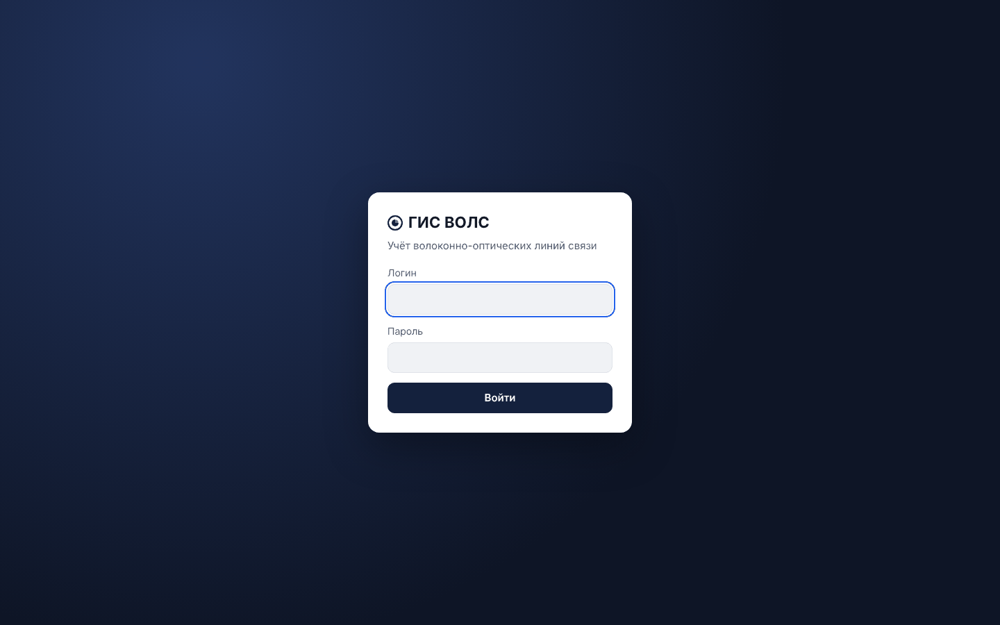

**Выход.** Кнопка с человечком справа вверху → **Выйти**.

## 3. Карта: из чего состоит экран

| Элемент | Где | Для чего |
|---|---|---|
| Строка поиска | сверху | найти колодец, муфту, кабель, адрес, IP, координаты — [раздел 4](#4-поиск) |
| Кнопка «Слои» (стопка листов) | справа от поиска | слои, фильтры по оператору и владельцу, подложки |
| Кнопка «Пользователь» (человечек) | справа сверху | меню со всеми страницами системы |
| Нижняя панель инструментов | снизу слева | Повреждение, Муфта по фото, Точка, Трасса, Перемычка, Кабель |
| Метка | справа | «Рядом со мной» — что вокруг вас (на телефоне) |
| Прицел | справа | показать моё местоположение |
| «+» / «−» | справа снизу | масштаб (колесо мыши и жесты тоже работают) |
| Линейка | слева снизу | масштаб карты в метрах |

### Условные обозначения

| На карте | Что это |
|---|---|
| Голубые и серые линии | трассы (канализация, подвес); цвет — владелец трассы |
| Цветные линии поверх трасс | кабели; цвет — оператор |
| Белый кружок | колодец; бежевый мелкий — опора; серый — здание |
| Жёлтый кружок с тёмной обводкой | узел связи (там стоят кроссы) |
| Жёлтый кружок с буквой «М» | муфта; цвет обводки — оператор |
| Квадратик у здания | узел доступа (коммутатор): зелёный — на связи, красный — недоступен, серый — нет данных |
| Красный «!» | повреждение в работе; серый «!» — устранённое, зелёная точка рядом — фактическое место |
| Фиолетовый пунктир | перемычка |
| Тёмный кружок с цифрой | группа объектов при мелком масштабе — приблизьте карту |

### Слои и фильтры

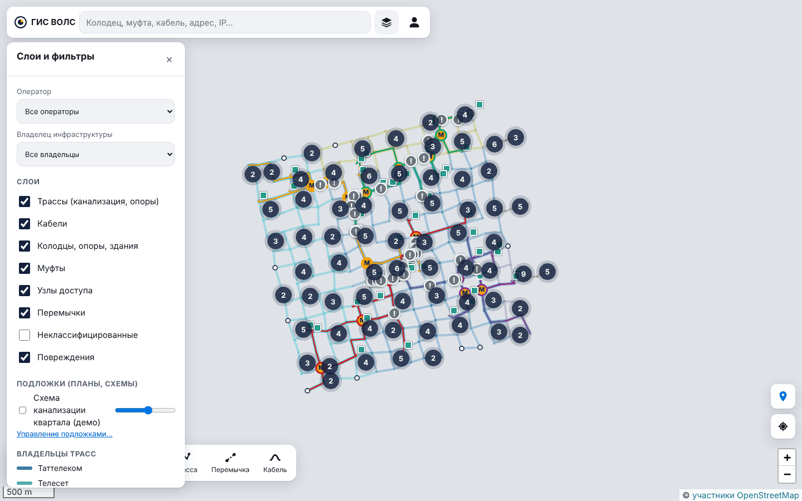

- **Оператор** — показать кабели и муфты только одного оператора.
- **Владелец инфраструктуры** — только трассы одного владельца.
- **Слои** — включение и выключение: трассы, кабели, колодцы, муфты, узлы доступа,
  перемычки, неклассифицированные, повреждения.
- **Подложки** — привязанные сканы планов ([раздел 21](#21-подложки--сканы-планов)) и
  ползунок прозрачности.
- Ниже — легенда цветов владельцев и операторов.

Пока действует фильтр, под строкой поиска видна плашка с его описанием и крестиком для сброса.
Фильтр и открытая карточка запоминаются в адресной строке — ссылку можно переслать коллеге.

### Меню пользователя

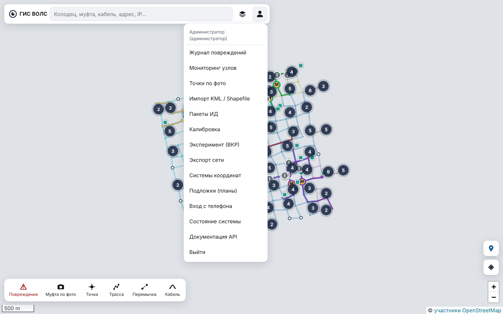

В меню собраны все страницы системы. Пункты, недоступные вашей роли, не показываются.

| Пункт | Раздел |
|---|---|
| Журнал повреждений | [12](#12-журнал-повреждений) |
| Мониторинг узлов | [14](#14-мониторинг-узлов-и-аварии) |
| Точки по фото | [17](#17-точки-по-фото-и-муфта-по-фото) |
| Импорт KML / Shapefile | [18](#18-импорт-kml-и-shapefile) |
| Пакеты ИД | [16](#16-пакеты-исполнительной-документации-ид) |
| Калибровка | [13](#13-калибровка) |
| Эксперимент (ВКР) | [23](#23-эксперимент-для-вкр) |
| Экспорт сети | [19](#19-экспорт-сети) |
| Системы координат | [20](#20-системы-координат-мск) |
| Подложки (планы) | [21](#21-подложки--сканы-планов) |
| Вход с телефона | [22](#22-работа-с-телефона) |
| Установить приложение | появляется, если браузер разрешает установку ([22](#22-работа-с-телефона)) |
| Состояние системы | версия, база, сводка по объектам |
| Документация API | описание программного интерфейса (для разработчиков) |

## 4. Поиск

Начните вводить в строку поиска — через полсекунды появится список. Ищется по:
- коду колодца или узла (`к.№780`, `53937`), названию и адресу;
- номеру муфты (`М1-1`), названию кабеля (`ТСТ-01/02`);
- имени коммутатора (hostname) и IP-адресу;
- **координатам**: широта и долгота (`55.700526, 52.363622`) или X Y в местной системе
  координат, если она добавлена ([раздел 20](#20-системы-координат-мск)).

Щелчок по строке результата открывает карточку объекта и приближает карту. Для координат
на карте ставится красный круг — щелчок по нему убирает его. `Esc` закрывает список.

## 5. Карточка объекта

Щелчок по любому объекту на карте открывает его карточку: справа на компьютере, шторкой
снизу на телефоне (потяните за полоску, чтобы развернуть).

В карточке:
- **кнопки действий** — зависят от типа объекта и роли;
- **свойства** — тип, код, адрес, длины, оператор, координаты (WGS 84 и, если добавлены,
  местные X/Y);
- **связанные объекты** — муфты и кроссы в узле, участки, кабели, запасы; щелчок открывает
  их карточки;
- **документы и фото**;
- **История** — кто, когда и что менял в этом объекте.

Карточки муфты и кабеля:

| Муфта | Кабель |
|---|---|
| 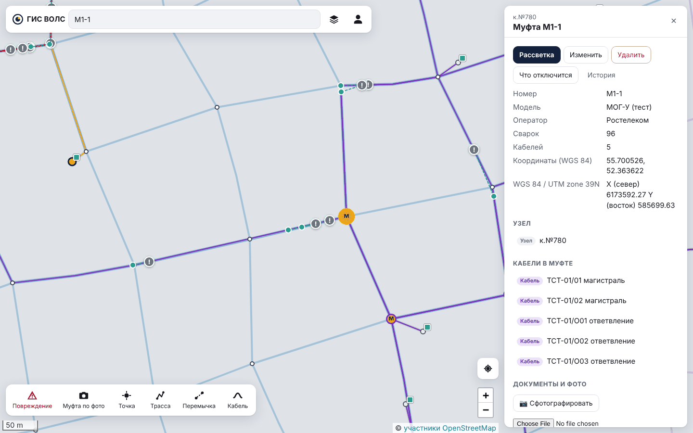 | 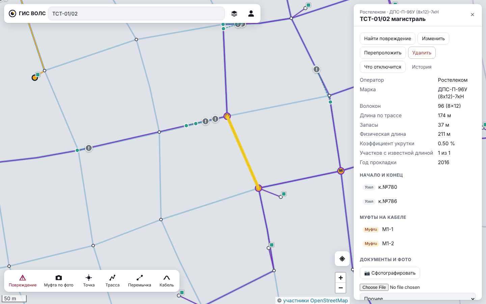 |

## 6. Ведение сети: точки, трассы, кабели

Инструменты рисования **Точка**, **Трасса**, **Кабель** есть у администратора на нижней
панели. Для точной привязки к колодцам работайте на крупном масштабе (система подскажет,
если карта слишком мелкая).

### Точка

**Точка** → щёлкните на карте место колодца, опоры или здания → выберите тип, код,
название, владельца → **Сохранить**. Если рядом уже есть точка, откроется она (так не
появляются дубли). Можно ставить точки одну за другой.

### Трасса

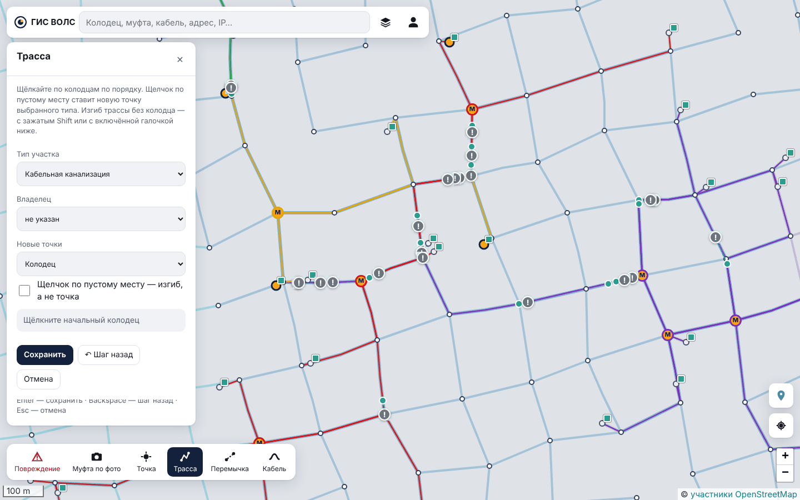

**Трасса** → щёлкайте колодцы по порядку.
- Щелчок по существующей точке — трасса прилипает к ней.
- Щелчок по пустому месту — новая точка (колодец).
- Изгиб без колодца — щелчок с зажатым **Shift**.
- **Enter** — сохранить, **Backspace** — шаг назад, **Esc** — отмена.

В карточке участка трассы:

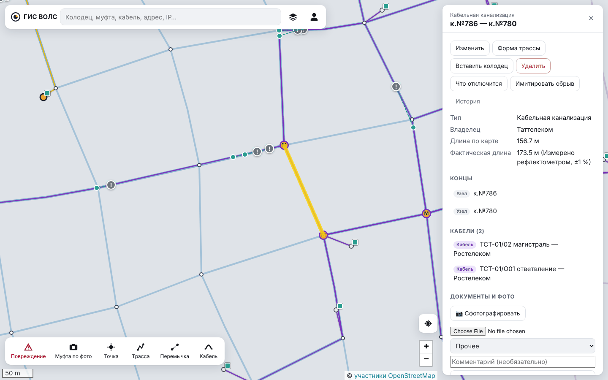

- **Изменить** — тип, владелец, название, число каналов, **фактическая длина и её
  источник** (рефлектометр, ИД, паспорт, оценка инженера). Источник важен: от него зависит
  погрешность локализации.
- **Форма трассы** — перетащите изгибы, чтобы линия шла по улице.
- **Вставить колодец** — щёлкните на участке место нового колодца: участок разделится на
  два, кабели пройдут через новую точку, известная длина поделится пропорционально.
- **Удалить**.

Монтажник видит в карточке участка кнопку **Уточнить длину** — если измерил участок на месте.

### Кабель

**Кабель** → щёлкните начало и конец кабеля: путь по трассам соберётся сам (кратчайший).
Если кабель идёт иначе, щёлкните промежуточные колодцы по порядку. Затем заполните
название, оператора, марку, укрутку, год прокладки → **Проложить**.

В карточке кабеля: **Найти повреждение**, **Изменить**, **Перепроложить** (собрать путь
заново), **Удалить**.

### Правка точки

В карточке точки (администратор):
- **Изменить** — тип, код, название, владелец, адрес, примечание;
- **Переместить** — щёлкните новое место, концы участков переедут вместе с точкой;
- **Объединить с…** — выберите на карте дубль: его участки, муфты и узлы доступа
  перейдут к этой точке, дубль удалится;
- **Поставить муфту**, **Поставить кросс**;
- **Удалить**.

### Неклассифицированные объекты

После импорта KML объекты, тип которых система не поняла, попадают в слой
«Неклассифицированные» (по умолчанию выключен). В их карточке — **Назначить тип**:
**Сделать точкой сети** или **Сделать участком трассы**.

## 7. Муфты и рассветка

**Поставить муфту** — в карточке точки (администратор): номер, модель, оператор, примечание.

**Рассветка** — схема сварок муфты. Откройте карточку муфты → **Рассветка**.

- Слева — **кабели в муфте**. Кабель, который проходит муфту транзитом, сначала нужно
  **разрезать здесь** (администратор) — у него появятся два конца.
- Вверху выберите кабель **Слева** и **Справа**. Щёлкните свободное волокно слева, затем
  справа — появится сварка (цветная линия).
- Щелчок по линии сварки — потери (дБ), примечание, **Разварить**.
- Блок **Сварить подряд** — сразу много волокон: «слева с ОВ», «справа с ОВ», количество.
- Таблица **Все сварки муфты** внизу страницы. Раздел **Замечания** подсказывает: какой
  кабель проходит транзитом и его нужно разрезать, у какой сварки потери выше нормы,
  сколько волокон кабеля ещё не подключено.
- **CSV для Excel** и **Печать** — выгрузка схемы. **На карте** — вернуться к муфте.

Цвета волокон и модулей — по маркировке кабеля (синий, оранжевый, зелёный…).

## 8. Кроссы и узлы доступа

**Поставить кросс** — в карточке узла связи или здания: название (ODF-1), число портов,
разъём, модель, оператор. В карточке узла связи видны его кроссы, узлы доступа, участки,
кабели и запасы.

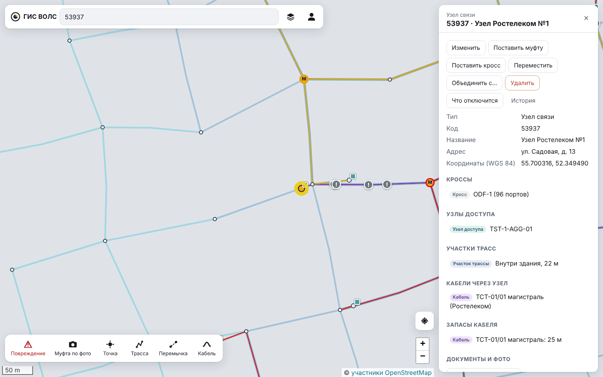

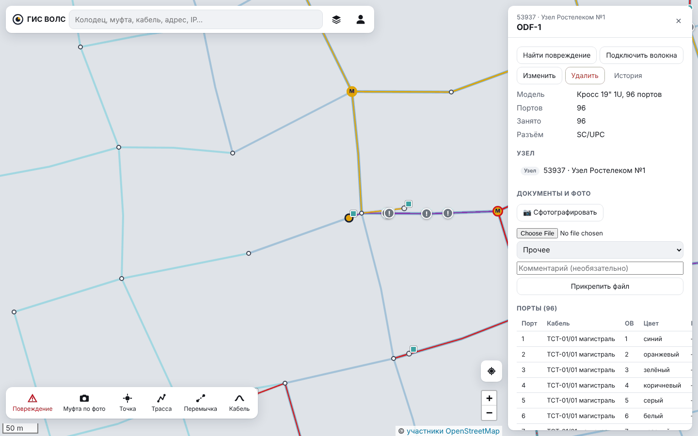

В карточке кросса:
- **Найти повреждение** — сразу открывает поиск с этим кроссом;
- **Подключить волокна** — волокна кабеля подряд на порты: кабель, «с волокна», «на порт»,
  «сколько подряд». Там же **Отключить порты**;
- **Изменить**, **Удалить** (администратор).

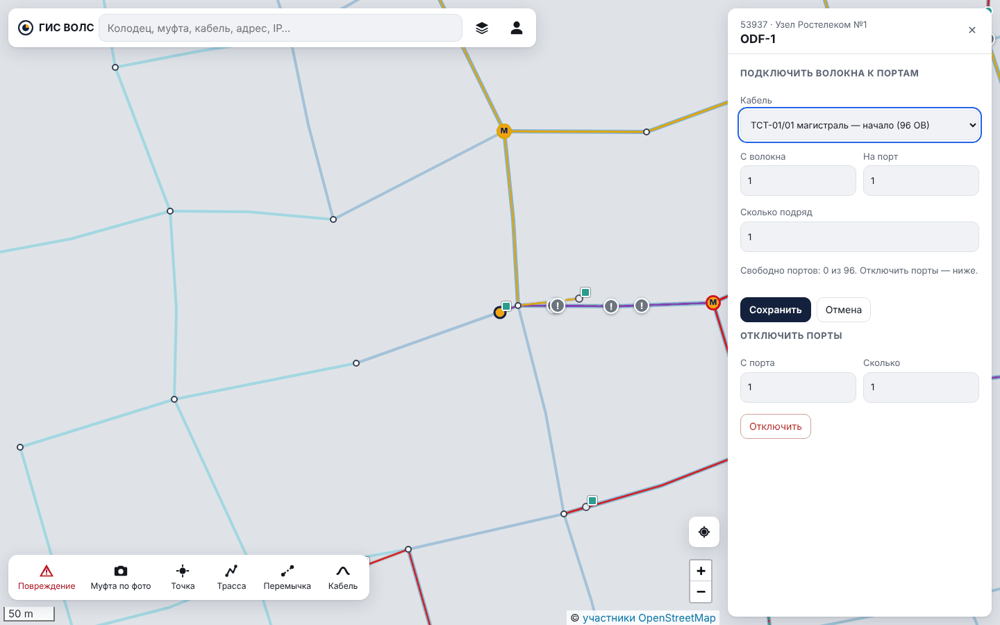

**Узел доступа** (коммутатор) — квадратик у здания. В его карточке: имя, IP, модель,
состояние, к какому порту кросса подключён, **Что отключится**, **Линейный тракт**.

## 9. Перемычки

Перемычка — линия с подписью между двумя объектами: патч-корд между кроссами, резерв
волокон между муфтами.

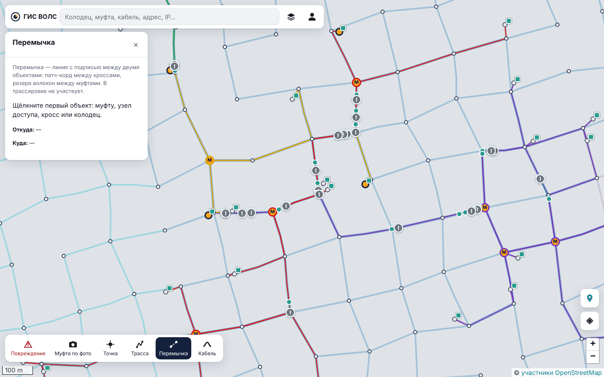

**Перемычка** на нижней панели → щёлкните первый объект (муфту, узел доступа, кросс или
колодец) → второй → введите подпись (например, «Резерв 24 волокна») → **Сохранить**. Объект ищется в радиусе около 20
пикселей от щелчка, приоритет — муфта, узел доступа, кросс, точка. **Заново** — выбрать
объекты снова.

В карточке перемычки: **Изменить подпись** (монтажник и администратор), **Удалить**
(администратор). В трассировке волокна перемычки не участвуют — это пометка на схеме.

## 10. Документы и фото

В любой карточке есть блок **Документы и фото**:
- **Сфотографировать** — на телефоне откроется камера; координаты съёмки сохраняются, и в
  карточке видно, в скольких метрах от объекта сделано фото;
- **Прикрепить файл** — выберите файл и тип (схема рассветки, схема трассы, паспорт, акт,
  фото, прочее), при необходимости комментарий.

Щелчок по названию открывает файл. Крестик — удалить (администратор).

## 11. Поиск места повреждения по рефлектометру

Это главная функция системы. Монтажник подключил рефлектометр к порту кросса и увидел
событие (обрыв, изгиб) на расстоянии L. Система проходит по волокну через все сварки,
учитывает укрутку кабелей и запасы в колодцах и показывает место на карте с интервалом
погрешности.

### Порядок действий

1. Нажмите **Повреждение** на нижней панели (или **Найти повреждение** в карточке кросса
   или кабеля).
2. Вкладка **Порт кросса**: начните вводить в поле «Кросс» код узла, адрес или название,
   выберите кросс в списке, затем **Порт** (в списке видно, какое волокно какого кабеля на
   нём). Вкладка **Волокно кабеля** — если меряли с конца кабеля без кросса: кабель,
   номер волокна, с начала или с конца кабеля.
3. **Расстояние по рефлектометру, м** — показание прибора до события.
4. **Найти место**.

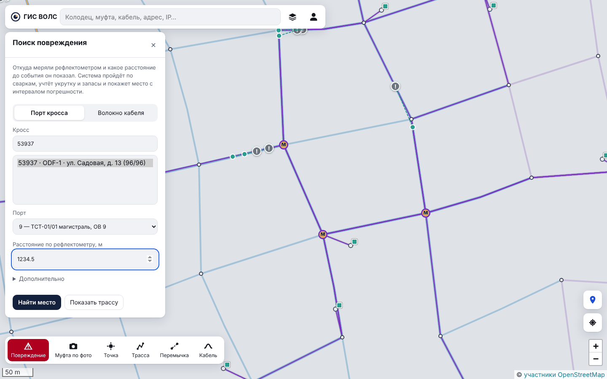

### Что показывает результат

- **Место** — участок между двумя колодцами и расстояния до них, кабель; на карте — точка
  и красная полоса интервала.
- **± N м (95 %)** — интервал: с вероятностью 95 % повреждение внутри него.
- **Проверить в первую очередь** — ближайшие колодцы, где удобно вскрывать.
- **Предупреждения** — например, «до места 2 участка с длиной только по карте — это
  основной источник ошибки».
- **Из чего складывается погрешность** — вклад каждого участка, запаса и укрутки. Это
  подсказка, какие длины уточнить, чтобы в следующий раз интервал был уже.

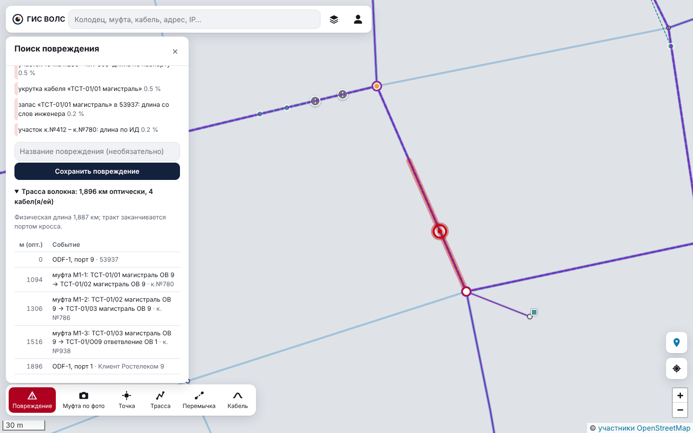

### Дополнительно

- **Измерительный шнур, м** — длина шнура между прибором и кроссом, вычитается из показания.
- **n в приборе** и **n волокна** — если в рефлектометре установлен другой показатель
  преломления, чем у волокна, расстояние пересчитывается.
- **Показание с другого конца, м** — если меряли с обеих сторон тракта. Система совмещает
  два измерения, интервал становится уже, а большое расхождение показывает ошибку в данных.

### Трасса волокна

**Показать трассу** — путь волокна на карте и таблица ожидаемых событий рефлектограммы:
на каком расстоянии будут сварки в муфтах и где конец тракта. Это удобно сверить с
рефлектограммой на приборе.

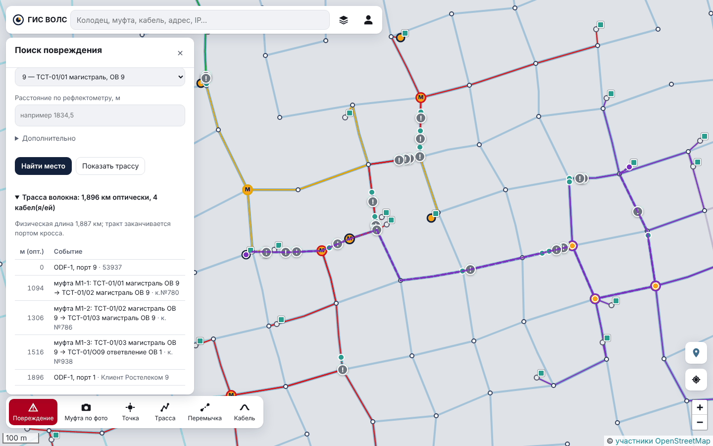

### Сохранение повреждения

Внизу результата (монтажник и администратор) — название и **Сохранить повреждение**.
Повреждение появится на карте (красный «!») и в журнале. На телефоне в карточке
повреждения есть кнопка **Маршрут** — Яндекс Карты построят путь до места.

## 12. Журнал повреждений

Меню → **Журнал повреждений**: все сохранённые повреждения со статусом, прогнозом, кабелем,
показанием рефлектометра, ошибкой прогноза и признаком «в интервале».

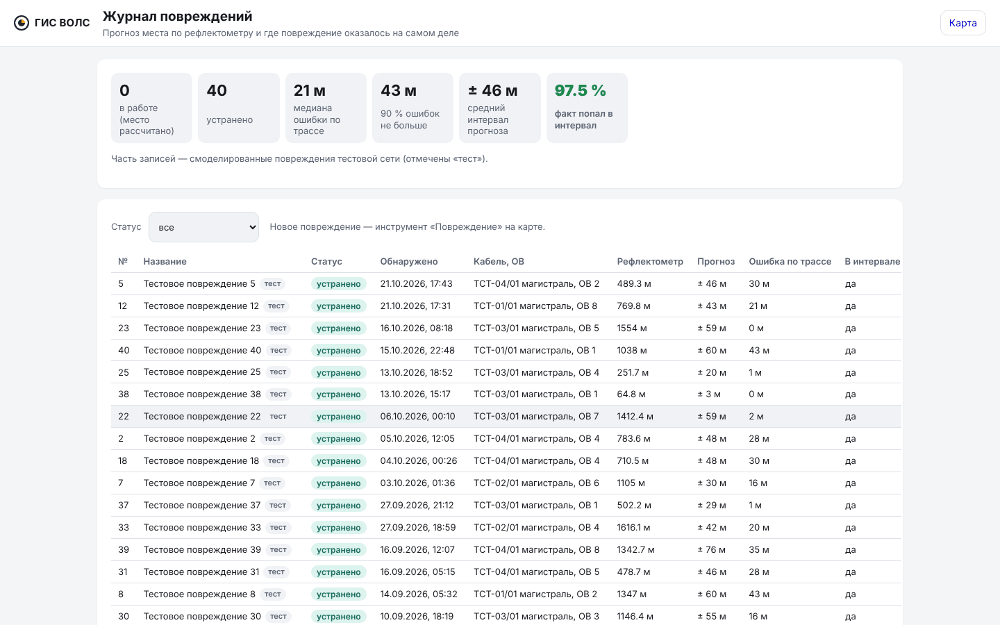

Фильтр сверху: все, место рассчитано, устранено, отменено. Щелчок по строке открывает
повреждение на карте.

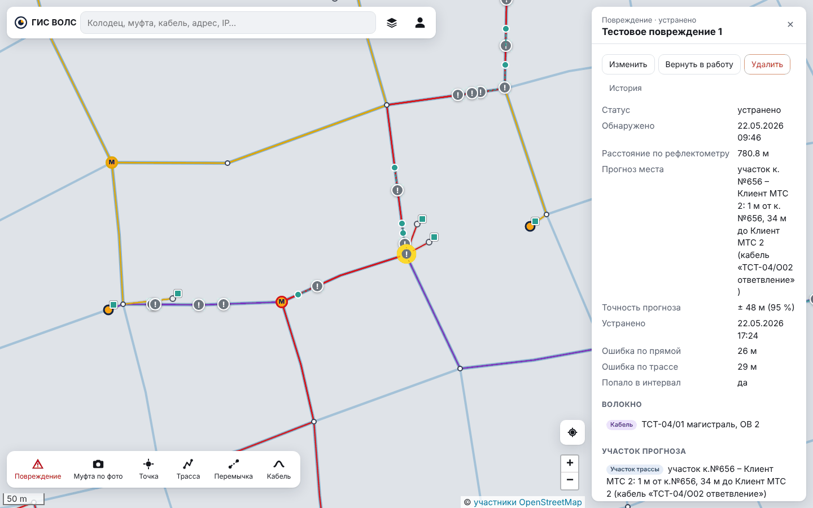

В карточке повреждения:
- **Отметить фактическое место** — после ремонта: **Я здесь — отметить по GPS** (на
  месте, с телефона) или **Указать на карте**. Система посчитает ошибку прогноза по трассе
  и проверит, попало ли место в интервал. Повреждение станет «устранено»;
- **Маршрут** — путь до места в Яндекс Картах;
- **Изменить** (название, примечание), **Отменить** / **Вернуть в работу**, **Удалить**
  (администратор).

Отмеченные фактические места — это данные для калибровки.

## 13. Калибровка

Точность локализации зависит от того, насколько верны длины в базе. Калибровка учится на
фактах:
- **измерения трактов из ИД** — оптическая длина между портами кроссов;
- **устранённые повреждения** с отмеченным фактическим местом.

По ним подбираются **укрутка для каждой марки кабеля** и **поправка «реальная трасса
длиннее нарисованной»** для участков, длина которых известна только по карте.

Меню → **Калибровка** (администратор) → **Рассчитать калибровку**. Расчёт ничего не меняет,
он показывает:
- сколько наблюдений использовано и найденную поправку карты;
- **проверку на отложенных данных**: часть наблюдений не участвует в подборе, и на ней
  видно, насколько точнее стали предсказания длин «до» и «после»;
- **моделирование повреждений на тестовой сети**: средняя и медианная ошибка места,
  ширина интервала и доля попаданий «до» и «после»;
- укрутку по маркам: было, стало, погрешность, число наблюдений.

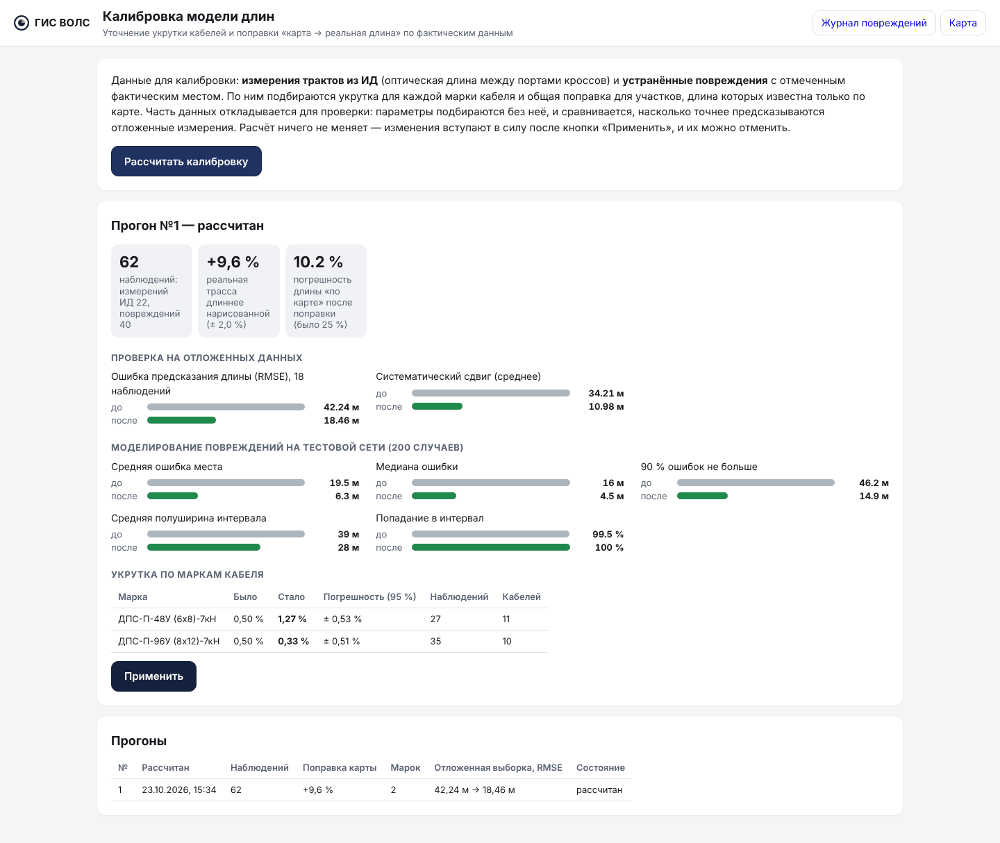

**Применить** — новые параметры вступают в силу для всех расчётов. **Отменить калибровку**
возвращает прежние значения. Все прогоны хранятся в таблице «Прогоны».

## 14. Мониторинг узлов и аварии

Система регулярно опрашивает коммутаторы (по умолчанию раз в 5 минут). Узел считается
недоступным после трёх пропусков подряд — так единичная потеря ответа не поднимает тревогу.

Меню → **Мониторинг узлов**:
- плитки «доступны / недоступны / нет данных / всего»;
- при аварии — блок **Авария**: **вероятное место обрыва** (участок, через который идут
  тракты всех недоступных узлов и ни одного работающего) с оценкой уверенности и
  подсказкой для рефлектометра: к какому порту подключиться и на каком расстоянии ждать
  обрыв. **Показать на карте**, **Карточка участка**, **Другие варианты**;
- таблица узлов с фильтром (все, недоступные, доступные, нет данных) и **лента событий**;
- **Опросить сейчас** — не дожидаясь расписания.

На карте авария показывается так: недоступные узлы обведены красным, вероятный участок
обрыва подсвечен, внизу — сообщение с подсказкой для рефлектометра.

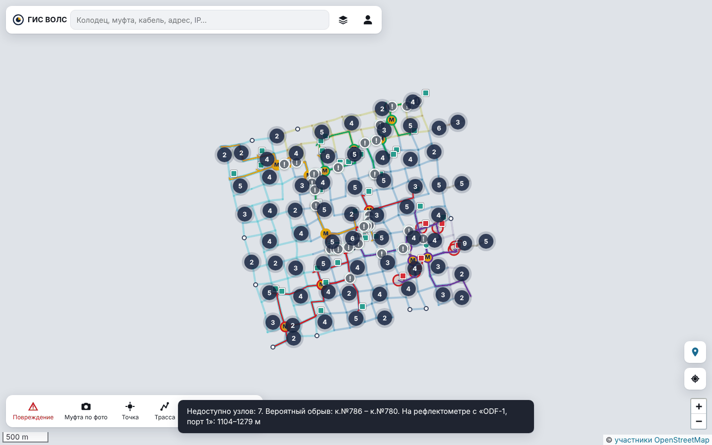

### Имитация на ноутбуке

На ноутбуке нет связи с реальными коммутаторами, поэтому включён режим **имитации**: узел
«не отвечает», если на его тракте оборван участок. Для показа (администратор):
- **Случайный обрыв кабеля** на странице мониторинга;
- **Имитировать обрыв** в карточке участка, **Имитировать отключение** в карточке узла
  доступа;
- **Снять все аварии** — восстановить связь.

Изредка имитатор сам «обрывает» случайный участок — как в жизни. Перед показом нажмите
**Снять все аварии**. На сервере компании в `.env` ставится `MONITORING_MODE=ping` —
тогда опрос настоящий.

## 15. Что отключится и линейный тракт

**Что отключится** — в карточке участка, кабеля, муфты, точки или узла доступа. Система
перечисляет узлы доступа, которые потеряют связь, если этот объект повредить, по
операторам. **Показать на карте** обводит их.

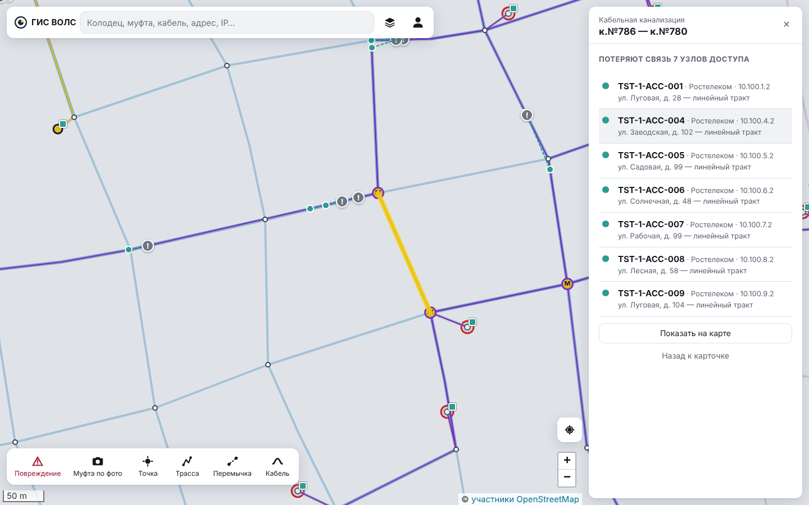

Это помогает, например, согласовать плановые работы: видно, каких абонентов предупредить.

**Линейный тракт** — в карточке узла доступа: весь путь сигнала от коммутатора до узла
связи подсвечивается на карте.

## 16. Пакеты исполнительной документации (ИД)

Подрядчик сдаёт пакет ИД: паспорт ВОЛП, схемы, протоколы измерений и монтажа муфт,
свидетельства о поверке приборов. Система разбирает пакет и находит несостыковки.

Меню → **Пакеты ИД** → перетащите PDF или Word (.docx) в рамку или нажмите на неё
(загружает администратор). Галочка «распознавать сканы (OCR)» включает распознавание
сканов (например, свидетельств о поверке); это может занять несколько минут — разбор идёт
в фоне, статус виден в списке.

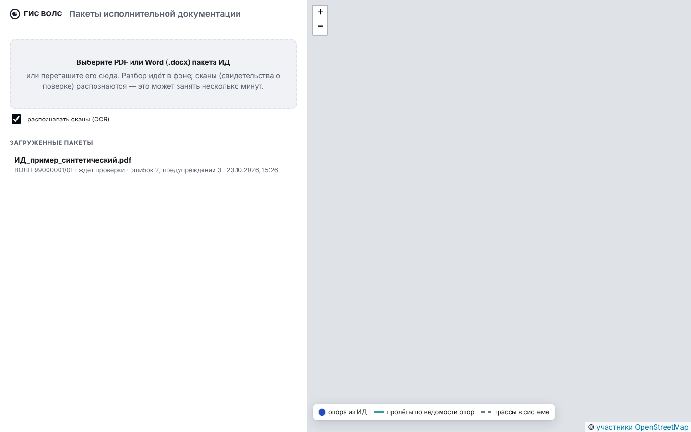

Откройте пакет из списка:

1. **Проверка пакета** — ошибки (красные), предупреждения (оранжевые), информация (серые)
   со ссылками на страницы документа: несовпадения номеров ВОЛП, длин, инициалов, цветов
   волокон, неверные расчёты, просроченная поверка. На карте справа — опоры из пакета.
2. Проверьте предложенные **кабель** и **порты** тракта → **Сверить с системой**: длины
   из ИД сравниваются с данными в базе.
3. Отметьте, что записать: измерение тракта, укрутку, приборы, узел доступа, опоры,
   **сварки** из протоколов монтажа муфт (муфта и кабели предлагаются сами) →
   **Подтвердить и записать**. Или **Отклонить пакет** с причиной — вернуть подрядчику.

Для пробы есть синтетический пакет с заложенными ошибками:
`data/samples/ИД_пример_синтетический.pdf`.

## 17. Точки по фото и муфта по фото

### Точки по фото

Меню → **Точки по фото** (монтажник, администратор) → **Выбрать фото** (до 60 за раз).
Координаты берутся из данных снимка (EXIF — включите в камере «Сохранять
местоположение») или распознаются с подписи на кадре (приложения «GPS-камера»: NoteCam,
GPS Map Camera, Timestamp Camera).

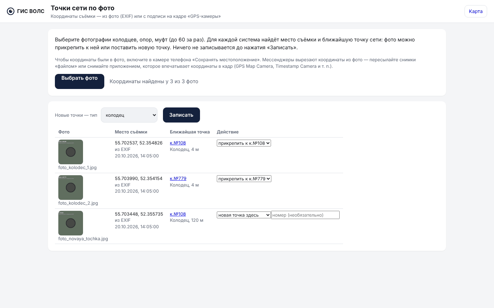

Для каждого фото видны место съёмки, ближайшая точка сети и расстояние до неё, и
предлагается действие: **прикрепить** к ближайшей точке или **новая точка здесь** (тип
новых точек выбирается сверху). Ничего не записывается до нажатия **Записать**.

Мессенджеры вырезают координаты из фото — пересылайте снимки «файлом».

### Муфта по фото

Кнопка **Муфта по фото** на нижней панели (монтажник, администратор): сфотографируйте муфту
камерой с координатами или выберите готовое фото. Система:
1. читает координаты и точность GPS с фото;
2. ставит муфту в ближайший колодец или на опору (до 1,5 × точности, 10–30 м);
3. если рядом только трасса (до 2 × точности, 15–40 м) — вставляет в трассу новую точку
   и ставит муфту в неё;
4. если рядом нет линий — ставит муфту в месте съёмки с пометкой «рядом нет линий связи —
   уточните место и заведите кабели».

Фото прикрепляется к муфте, открывается её карточка.

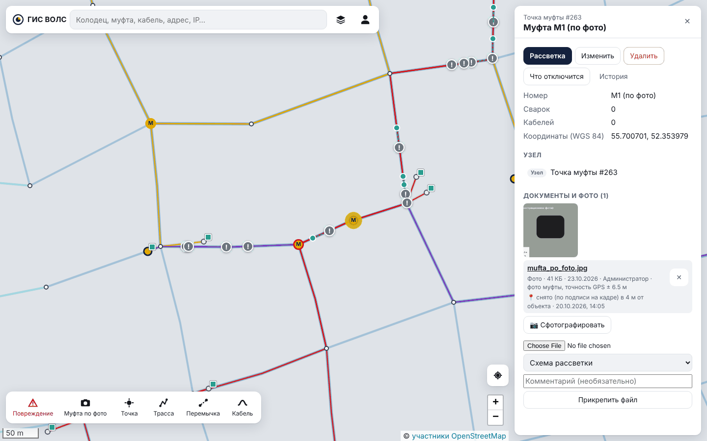

## 18. Импорт KML и Shapefile

Меню → **Импорт KML / Shapefile** (администратор).

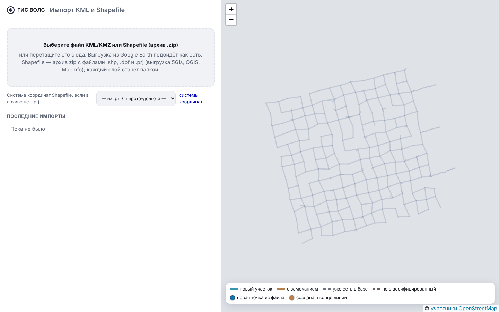

1. Выберите файл: KML или KMZ из Google Earth, или **архив .zip с Shapefile** (файлы .shp,
   .dbf, .prj; выгрузка 5Gis, MapInfo, QGIS, AutoCAD Map). Если в архиве нет .prj, а
   координаты в метрах, выберите **систему координат** в списке.
2. **Папки файла** — для каждой папки (у Shapefile — слоя) система предлагает, что это:
   точки сети, участки трасс, кабели, муфты, не импортировать; тип и владельца. Выбор
   запоминается для следующих файлов. Если в атрибутах Shapefile есть поле типа (TYPE, ТИП,
   СЛОЙ), слой разбивается на подпапки по его значениям.
3. **Допуск привязки концов** — на каком расстоянии конец линии «прилипает» к существующей
   точке (по умолчанию 10 м). **Обновить предпросмотр** после изменений.
4. **Что будет сделано** — сколько новых участков и точек, что уже есть в базе; на карте
   справа — предпросмотр (новые участки зелёные, с замечаниями — оранжевые, уже
   существующие — пунктир).
5. **Замечания** — с ссылкой на объект; «показывать информационные» — подробнее.
6. **Записать в базу**. Повторная загрузка того же файла дублей не создаёт.

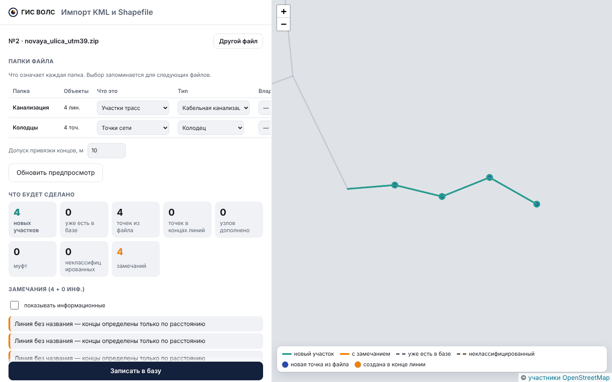

## 19. Экспорт сети

Меню → **Экспорт сети** (администратор):
- **KML** — для Google Earth;
- **Shapefile (zip)** — для QGIS, 5Gis, MapInfo, AutoCAD Map: слои «точки», «трассы»,
  «кабели» и описание полей; можно выбрать **систему координат** (WGS 84 или МСК из списка);
- **GeoJSON** — для веб-ГИС и QGIS.

Можно выгрузить только одного **оператора**. **Скачать** — файл сохранится в папку загрузок.

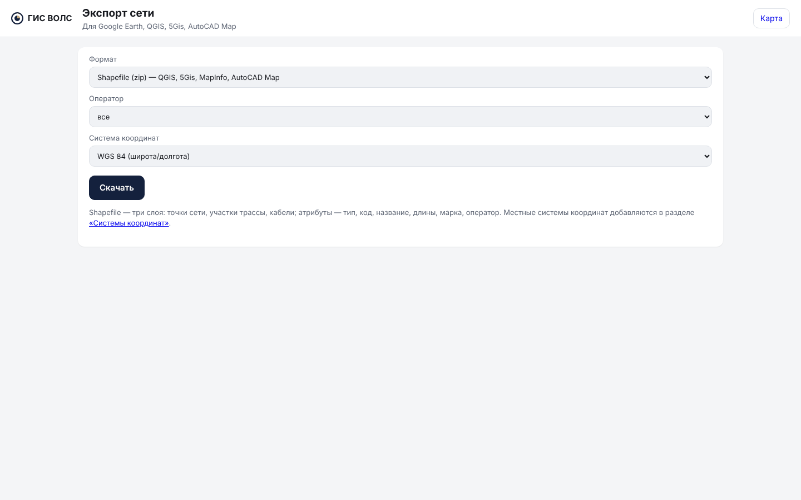

## 20. Системы координат (МСК)

Сеть хранится в широте и долготе (WGS 84) — в них работают карты и GPS. Но проекты и
исполнительные съёмки обычно в **местной системе координат** субъекта (МСК) в метрах.

Меню → **Системы координат** (администратор):
1. Приложите **файл .prj** из 5Gis, MapInfo, QGIS или AutoCAD — в нём точные параметры
   системы (параметры МСК официально не публикуются, вручную их не вводят). Можно вставить
   определение текстом: WKT, строку `+proj=…` или код `EPSG:…`.
2. Название можно не вводить — оно возьмётся из .prj.
3. «Показывать координаты в карточках объектов» — включено по умолчанию.
4. **Добавить**. Система пересчитает пробную точку, чтобы проверить определение.

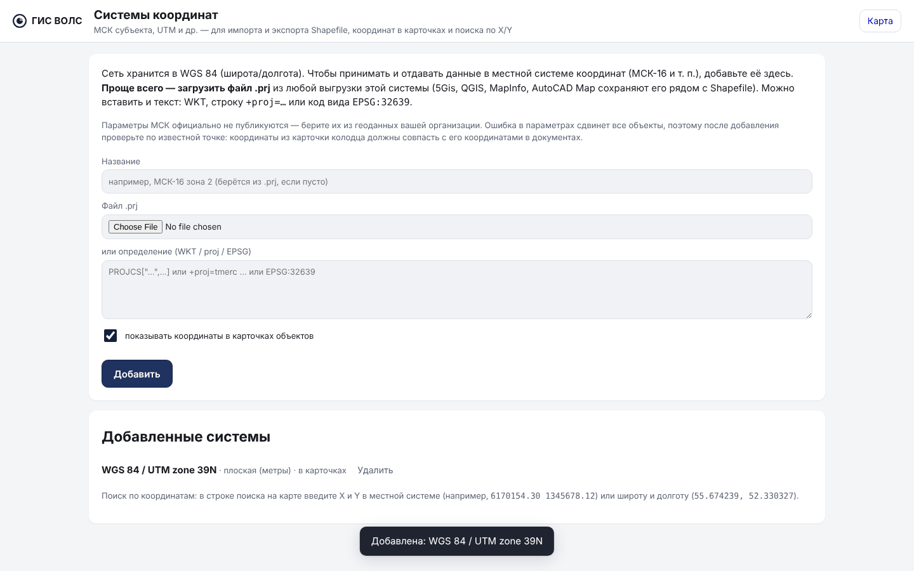

После добавления:
- в карточках точек и муфт — строка с координатами «X (север) / Y (восток)» в этой системе;
- в поиске можно ввести `X Y` из проекта — система попробует все системы и оба порядка
  осей и покажет точку в районе сети;
- при импорте Shapefile без .prj систему можно выбрать в списке;
- экспорт Shapefile можно сделать в этой системе.

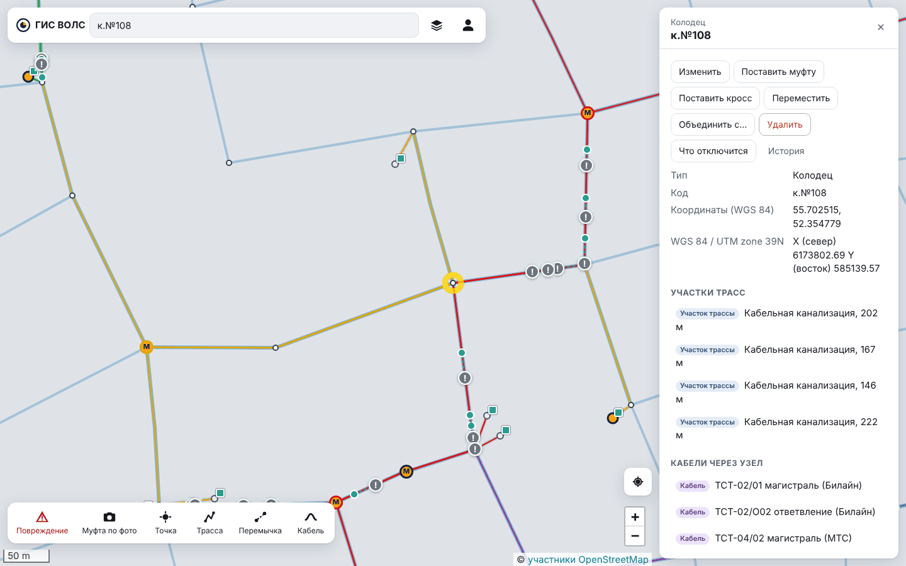

После добавления МСК проверьте её по известной точке: X/Y из карточки колодца должны
совпасть с его координатами в документах. Ошибка в параметрах сдвинет все объекты.

## 21. Подложки — сканы планов

Подложка — скан или PDF плана (ситуационный план, схема канализации), привязанный к карте
и показанный полупрозрачно под сетью.

Меню → **Подложки (планы)** (администратор):
1. **Файл плана** — PDF, PNG или JPG; у PDF — номер страницы. **Название**. **Загрузить**.
2. Откроется привязка: слева план, справа карта с трассами сети.
3. Щёлкните точку на плане (угол дома, перекрёсток, колодец), затем то же место на карте.
   На карте видны трассы и колодцы сети: наведите на колодец — появится его код, щелчок по
   колодцу ставит точку точно в его центр. Точки нумеруются. Нужно **минимум 3 точки**,
   лучше 4–6 **по краям плана**. Повторный щелчок по плану до отметки на карте переставляет
   точку.
4. При 4 и более точках видна **невязка** — на сколько метров каждая точка не совпала.
   Если у одной точки невязка намного больше остальных — она отмечена неверно: **Убрать
   последнюю точку** и поставить заново.
5. План сразу показывается на карте справа — проверьте совпадение. **Прозрачность на
   карте** — ползунок. **Сохранить привязку**.

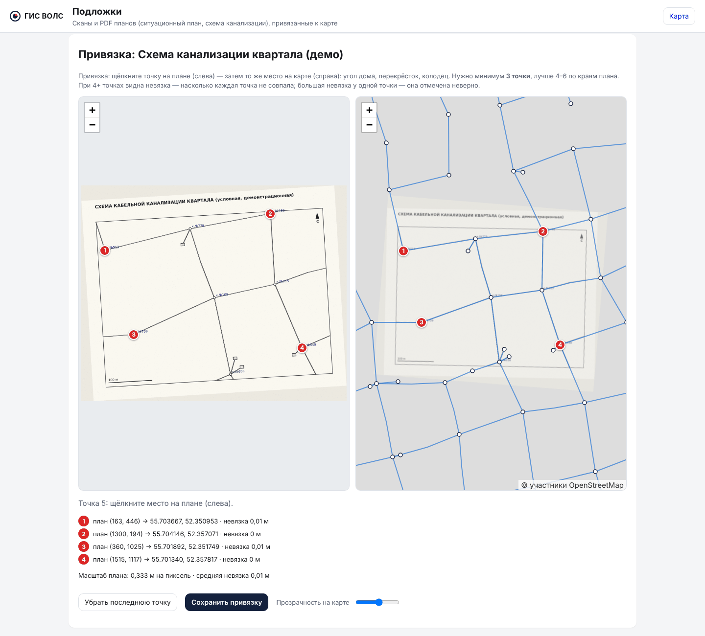

На карте подложка включается в панели **Слои** → «Подложки», там же прозрачность.

План привязывается сдвигом, поворотом и масштабом. Если скан сильно измят или
сфотографирован под углом, точного совпадения по всему листу не будет.

## 22. Работа с телефона

### Подключение (один раз)

1. Телефон и ноутбук — в одной Wi-Fi-сети, система запущена.
2. На ноутбуке дважды щёлкните **`phone.bat`**: он найдёт адрес ноутбука, попросит
   разрешение администратора Windows на открытие порта 8443 (один раз) и откроет страницу
   с QR-кодом.
3. Наведите камеру телефона на QR-код. Браузер предупредит о сертификате —
   «Дополнительно» → «Перейти на сайт» (или установите корневой сертификат по ссылке на
   той же странице, тогда предупреждения не будет).
4. Войдите (например, `montazhnik`), разрешите доступ к местоположению и камере.

Если адрес ноутбука в Wi-Fi поменялся, запустите `phone.bat` ещё раз. На сервере компании
адрес задаётся в `.env` (`PHONE_HOST`).

### Установка как приложение

В меню браузера выберите **«Установить приложение»** или **«На главный экран»**. Значок
«ГИС ВОЛС» откроет систему во весь экран, без адресной строки. На компьютере такой же пункт
есть в меню пользователя.

**Без связи** (колодец, подвал, загород) открывается последняя загруженная карта с плашкой
«Нет связи»: сеть и подложка просмотренных районов видны, изменения сохранить нельзя.
Когда связь вернётся, плашка исчезнет.

### На телефоне

| Карта | Рядом со мной | Карточка |
|---|---|---|
| 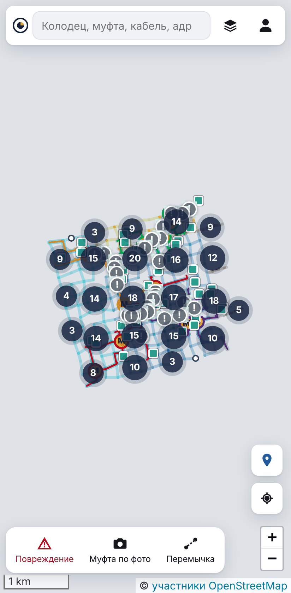 |  | 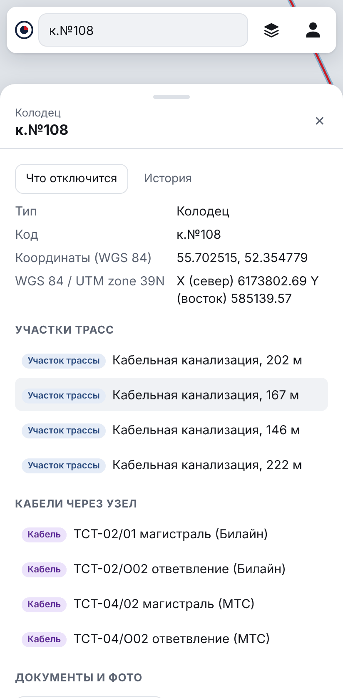 |

- **Метка справа** — **Рядом со мной**: точки сети в радиусе 300 м с расстоянием и
  вкладка **Повреждения** в работе с расстоянием и кнопкой **Маршрут** (Яндекс Карты).
- **Прицел** — моё местоположение.
- Карточка — шторка снизу, потяните вверх, чтобы развернуть.
- **Отметить фактическое место → Я здесь — отметить по GPS** — в карточке повреждения.
- **Сфотографировать** — в любой карточке.
- **Муфта по фото** — на нижней панели ([раздел 17](#17-точки-по-фото-и-муфта-по-фото)).

## 23. Эксперимент для ВКР

Меню → **Эксперимент (ВКР)** (администратор). Опыты идут **в отдельной базе** — рабочая
сеть не меняется. Генерируются сети с известной «правдой», на них моделируются
повреждения и обрывы, ответы системы сравниваются с правдой.

- **Запустить быстрый** — около 3 минут; **Запустить полный** — 10–30 минут.
- Результат — графики и таблицы:
  - E1 — точность системы против ручных способов (по карте, по документации);
  - E2 — влияние качества данных;
  - E3 — кривая калибровки: сколько ремонтов нужно, чтобы точность выросла;
  - E4 — поиск места обрыва по аварии коммутаторов;
  - E5 — быстродействие на сетях разного размера.
- **Отчёт для ВКР (Markdown)** и таблицы для Excel (CSV).

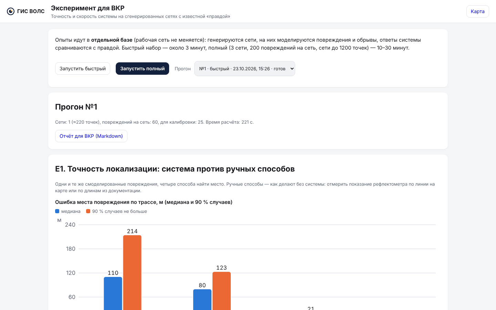

Результаты полного прогона — в [experiment-results.md](../vkr/experiment-results.md).

## 24. Администрирование

Команды выполняются в окне командной строки в папке проекта при запущенной системе.

| Задача | Как |
|---|---|
| Создать пользователя | `docker compose exec app python -m app.cli create-user ivanov Пароль123 --role installer --name "Иванов И.И."` (роли: `admin`, `installer`, `viewer`) |
| Тестовая сеть и демо-пользователи | `generate.bat` (сеть заменяется!) |
| Убрать тестовую сеть, оставив импорт и нарисованное | `clear_test_data.bat` |
| Сколько объектов в базе | `docker compose exec app python -m app.cli stats` |
| Файлы для демонстрации по текущей сети | `docker compose exec app python -m app.cli demo-files --out /tmp/demo`, затем `docker compose cp app:/tmp/demo .\demo` |
| Резервная копия базы | `docker compose exec db pg_dump -U vols vols > backup.sql` |
| Журнал приложения | `docker compose logs app` |
| Состояние системы | меню → Состояние системы, или <http://localhost:8000/status.html> |

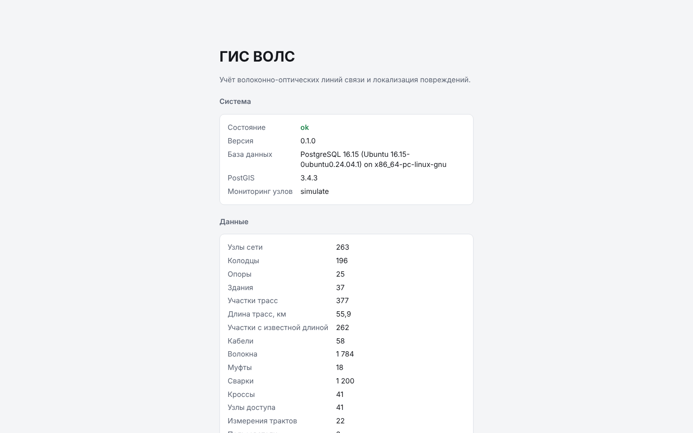

Готовые демонстрационные файлы для сети из `generate.bat` лежат в `data/samples/demo/`
(см. `README.txt` там же).

Основные настройки — в файле `.env` (образец — `.env.example`): режим мониторинга
(`MONITORING_MODE`: simulate / ping / off), интервал и порог опроса, адрес для телефонов
(`PHONE_HOST`), порты.

На сервере компании смените пароли демонстрационных пользователей (создайте личные учётные
записи) и не запускайте `generate.bat` — он заменяет сеть.

## 25. Если что-то не так

| Ситуация | Что делать |
|---|---|
| `start.bat` пишет, что Docker не запущен | запустите Docker Desktop и дождитесь «Engine running» |
| Браузер не открывает localhost:8000 | подождите минуту после запуска; `docker compose ps` — контейнеры должны быть «running/healthy» |
| На карте нет улиц | нет интернета — подложка OpenStreetMap не грузится; сеть при этом видна |
| На карте пусто | нет данных: запустите `generate.bat` или импортируйте KML/Shapefile |
| «Приблизьте карту» при рисовании | работайте на крупном масштабе — так точнее привязка к колодцам |
| Поиск повреждения: «Выберите кросс и порт» | выберите кросс в списке под полем и порт с подключённым волокном |
| Порт в списке серый | к нему не подключено волокно — **Подключить волокна** в карточке кросса |
| «В рассветке петля» / «конец волокна никуда не подключён» | проверьте сварки в муфтах по пути (трасса волокна покажет, где обрывается путь) |
| Большой интервал ± | смотрите «Из чего складывается погрешность»: уточните длины этих участков по ИД или рефлектометру, отметьте фактические места ремонтов и запустите калибровку |
| На фото не найдены координаты | включите в камере «Сохранять местоположение» или снимайте приложением с подписью координат; не пересылайте через мессенджер |
| Телефон не открывает адрес | одна Wi-Fi-сеть с ноутбуком, запустите `phone.bat` заново; в гостевых сетях устройства часто изолированы |
| Геолокация на телефоне не работает | система должна открываться по **https** (адрес из `phone.bat`) и с разрешением на местоположение |
| Мониторинг сам показал аварию | в режиме имитации изредка случаются случайные обрывы: **Снять все аварии** |
| Импорт: «координаты не похожи на широту/долготу» | в архиве нет .prj — выберите систему координат в списке |
| После импорта точки «вне Земли» | выбрана не та система координат |

## 26. Словарь

| Термин | Значение |
|---|---|
| ВОЛС, ВОЛП | волоконно-оптическая линия связи / передачи |
| Трасса, участок | путь между двумя точками сети (канализация, подвес по опорам, внутри здания), по которому идут кабели |
| Кабельная канализация, колодец, ККС | подземные трубы для кабелей и колодцы для доступа к ним |
| Муфта | место сварки волокон двух и более кабелей |
| Рассветка | схема сварок в муфте: какое волокно с каким соединено |
| Кросс (ODF) | оптический распределительный щит в узле или здании, волокна выведены на порты |
| Узел доступа | коммутатор оператора, к которому подключены абоненты |
| Линейный тракт | путь сигнала от узла доступа до узла связи по волокнам |
| Рефлектометр (OTDR) | прибор, показывающий расстояние до событий в волокне (сварка, обрыв) |
| Оптическая длина | расстояние по волокну; больше физической из-за укрутки |
| Укрутка | на сколько процентов волокно в кабеле длиннее самого кабеля |
| Запас | кольцо кабеля в колодце или на опоре |
| Интервал (95 %) | диапазон, в котором повреждение находится с вероятностью 95 % |
| Калибровка | уточнение укрутки и поправки длин по фактическим данным |
| ИД | исполнительная документация, которую сдаёт подрядчик после строительства |
| МСК | местная система координат субъекта РФ, координаты в метрах |
| WGS 84 | система координат GPS и веб-карт (широта, долгота) |
| Shapefile, KML | форматы обмена геоданными (ГИС / Google Earth) |
| Подложка | план или схема, показанная под сетью на карте |
| Невязка | на сколько метров опорная точка привязки не совпала после расчёта |

## 27. Приложение. Права по ролям

| Действие | Администратор | Монтажник | Просмотр |
|---|:-:|:-:|:-:|
| Смотреть карту, карточки, журнал, мониторинг | ✅ | ✅ | ✅ |
| Поиск места повреждения, трасса волокна | ✅ | ✅ | ✅ |
| Сохранить повреждение, отметить фактическое место | ✅ | ✅ | — |
| Что отключится, линейный тракт | ✅ | ✅ | ✅ |
| Рисовать и править точки, трассы, кабели | ✅ | — | — |
| Уточнить длину участка | ✅ | ✅ | — |
| Поставить муфту / кросс, разрезать кабель в муфте | ✅ | — | — |
| Варить волокна в рассветке, подключать порты кросса | ✅ | ✅ | — |
| Перемычки: создать, изменить подпись | ✅ | ✅ | — |
| Удалить перемычку, документ, повреждение | ✅ | — | — |
| Прикрепить фото и документы, муфта по фото, точки по фото | ✅ | ✅ | — |
| Пакеты ИД: смотреть, сверять | ✅ | ✅ | — |
| Пакеты ИД: загрузить, подтвердить, отклонить | ✅ | — | — |
| Опросить узлы сейчас | ✅ | ✅ | — |
| Имитация аварий | ✅ | — | — |
| Импорт, экспорт, системы координат, подложки | ✅ | — | — |
| Калибровка, эксперимент | ✅ | — | — |
